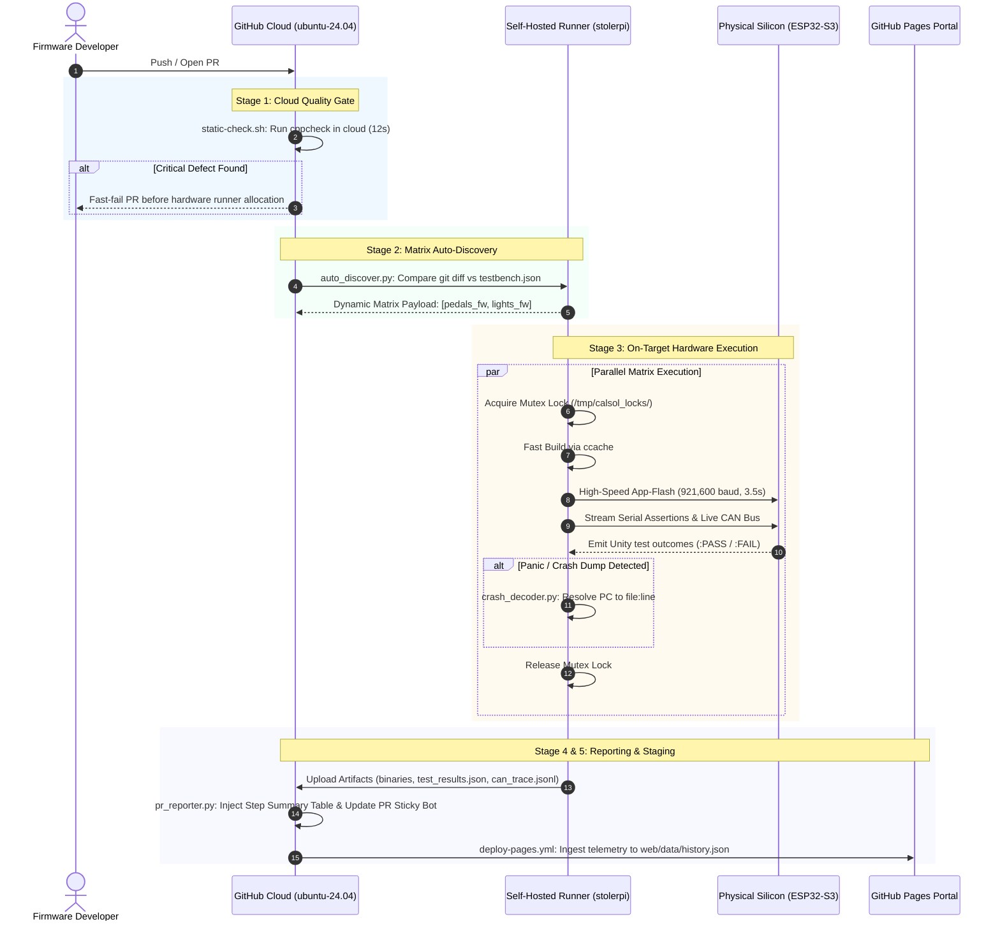

# CalSol Gen 11 Hardware-in-the-Loop (HIL) Testbench & CI Platform

[](https://github.com/JuneKim0712/CAN-Testbench/actions)


| **[Overview]** | [Tutorial](docs/TUTORIAL.md) | [Contributing](CONTRIBUTING.md) | [Architecture](docs/CODE_DOCUMENTATION.md) | [Bench Manual](docs/CAN_TESTBENCH_STAGE_GUIDE.md) | [Hardware Setup](docs/SETUP_GUIDE.md) | [Debugging](docs/DEBUGGING_GUIDE.md) | [Live Portal ↗](https://junekim0712.github.io/CAN-Testbench/) |
| :---: | :---: | :---: | :---: | :---: | :---: | :---: | :---: |

Continuous hardware integration, automated on-target silicon testing, and CAN bus telemetry validation for the UC Berkeley Solar Vehicle Team (**CalSol**).

This platform validates embedded vehicle firmware on physical microcontrollers and differential bus hardware before deployment to the Gen 11 solar car, serving both as the automated Hardware-in-the-Loop (HIL) test harness and as the reusable CI workflow engine for [`CalSol/Gen11-FW`](https://github.com/CalSol/Gen11-FW).

---

## Documentation Tabs & Guides

| Tab / Guide | Primary Purpose | Best For |
| :--- | :--- | :--- |
| **[Tutorial](docs/TUTORIAL.md)** | 5-minute quickstart guide: write and run your first unit test on silicon. | New firmware engineers & recruits |
| **[Architecture](docs/CODE_DOCUMENTATION.md)** | Deep technical reference: TWAI C driver, FreeRTOS queue mechanics, daemons, and virtual ECUs. | Firmware developers & driver authors |
| **[Bench Manual](docs/CAN_TESTBENCH_STAGE_GUIDE.md)** | Step-by-step operational guide: bench progression, remote access, and snoop/inject CLI tools. | Lab operators & test engineers |
| **[Hardware Setup](docs/SETUP_GUIDE.md)** | Full physical commissioning: ESP32-S3 pinouts, differential bus wiring, udev symlinks, and ESP-IDF. | Setting up a new lab runner or laptop |
| **[Debugging](docs/DEBUGGING_GUIDE.md)** | Failure triage manual, crash backtrace decoder, serial monitor logs, and triage matrix. | Debugging test failures & panics |
| **[Telemetry Portal](https://junekim0712.github.io/CAN-Testbench/)** | Interactive web dashboard: real-time CAN waveforms, historic test assertions, and packet inspector. | Reviewing test run history & signals |

---

## Table of Contents
1. [System Overview & Architecture Topology](#1-system-overview--architecture-topology)
2. [Reusable GitHub Actions CI Integration](#2-reusable-github-actions-ci-integration)
   - [2.1 The 13-Line Reusable Workflow (`testbench.yml`)](#21-the-13-line-reusable-workflow-testbenchyml)
   - [2.2 Subsystem Configuration Manifest (`testbench.json`)](#22-subsystem-configuration-manifest-testbenchjson)
   - [2.3 Dynamic Change Detection & Auto-Discovery](#23-dynamic-change-detection--auto-discovery)
3. [CI Pipeline Stages & Execution Flow](#3-ci-pipeline-stages--execution-flow)
   - [3.1 End-to-End Pipeline Sequence](#31-end-to-end-pipeline-sequence)
   - [3.2 Stage Breakdown (Cloud Gate, Discovery, Hardware Matrix, Reporting, Pages)](#32-stage-breakdown)
4. [Inspecting Test Results & Telemetry on GitHub](#4-inspecting-test-results--telemetry-on-github)
   - [4.1 Dedicated Step Summary Tables](#41-dedicated-step-summary-tables)
   - [4.2 Automated Crash Backtrace Decoding](#42-automated-crash-backtrace-decoding)
   - [4.3 Downloading Precompiled Trackside Binaries](#43-downloading-precompiled-trackside-binaries)
5. [Repository Layout](#5-repository-layout)
6. [Trackside Flashing & Safety Protocols](#6-trackside-flashing--safety-protocols)

---

## 1. System Overview & Architecture Topology

The testbench operates on a dedicated physical host (`stolerpi` (Raspberry Pi 5)) directly wired to dual ESP32-S3 microcontroller nodes sharing a physical, differential 500 kbps CAN 2.0B bus:

```text
 ┌────────────────────────────────────────────────────────────────────────┐
 │                      Raspberry Pi 5 Host (stolerpi)                    │
 │                                                                        │
 │   ┌───────────────────────┐              ┌─────────────────────────┐   │
 │   │  HIL Test Runner      │              │  CAN Bridge Daemon      │   │
 │   │  (cal-test.sh)        │              │  (can_bridge_daemon.py) │   │
 │   └──────────┬────────────┘              └────────────┬────────────┘   │
 └──────────────┼────────────────────────────────────────┼────────────────┘
                │ USB CDC-ACM                            │ USB CDC-ACM
                ▼ (/dev/esp32_johnathan)                 ▼ (/dev/esp32_ahmed)
 ┌─────────────────────────────────┐        ┌─────────────────────────────┐
 │  Node 2: Device Under Test      │        │  Node 1: CAN Bus Debugger   │
 │  ESP32-S3 Microcontroller       │        │  ESP32-S3 Microcontroller   │
 │  TI TCAN332 CAN Transceiver     │        │  TI TCAN332 CAN Transceiver │
 └────────────────┬────────────────┘        └──────────────┬──────────────┘
                  │                                        │
                  ▼                                        ▼
 ══════════════════════════════════════════════════════════════════════════
               Physical CAN 2.0B Bus (500 kbps, 120Ω Terminated)
 ══════════════════════════════════════════════════════════════════════════
```

| Node | Physical Port Symlink | Role | Details |
| :--- | :--- | :--- | :--- |
| **Node 1** | `/dev/esp32_ahmed` | **CAN Bus Debugger** | Dedicated passive listener. Samples differential traffic at 500 kbps, decodes COBS frames, and broadcasts events to `/tmp/calsol_can.sock`. |
| **Node 2** | `/dev/esp32_johnathan` | **Device Under Test (DUT)** | Target node. Flashed on-the-fly with subsystem unit test firmware (`pedals_fw`, `lights_fw`). Evaluated for Unity assertions. |
| **Bus Backbone** | Differential Twisted Pair | **CAN 2.0B Vehicle Bus** | High-speed vehicle bus (500 kbps, 20 Time Quanta, 80% sample point) terminated with dual $120\,\Omega$ split termination resistors ($60\,\Omega$ equivalent). |

[↑ Back to top](#table-of-contents)

---

## 2. Reusable GitHub Actions CI Integration

Follow this guide to connect any CalSol firmware repository (such as [`CalSol/Gen11-FW`](https://github.com/CalSol/Gen11-FW) or an individual ECU fork) to the automated hardware testbench.

### 2.1 The 13-Line Reusable Workflow (`testbench.yml`)

Add `.github/workflows/testbench.yml` to your firmware repository. This delegates all static analysis, matrix scheduling, and physical silicon flashing to the central testbench engine:

```yaml
name: CalSol Hardware CI

on:
  push:
    branches: [ main ]
  pull_request:
    branches: [ main ]
  workflow_dispatch:
    inputs:
      target:
        description: 'Target subsystem folder ("auto", "all", or explicit path)'
        required: false
        default: 'auto'
      port:
        description: 'Serial port override (optional, e.g. /dev/esp32_johnathan)'
        required: false
        default: ''

jobs:
  hardware-verification:
    name: Execute On-Target Hardware Testbench
    uses: CalSol/CAN_TestBench/.github/workflows/testbench.yml@main
    with:
      target: ${{ inputs.target || 'auto' }}
      port: ${{ inputs.port || '' }}
```

> [!TIP]
> The reusable workflow operates without modifying repository code. To test a single subsystem on demand, use the **Run workflow** dropdown in the GitHub Actions UI and specify the target folder name.

### 2.2 Subsystem Configuration Manifest (`testbench.json`)

The CI discovery engine scans the repository for `testbench.json` files. Add this manifest to the root of each ECU subsystem folder you want tested:

```json
{
  "name": "pedals_fw",
  "target": "pedals_fw/test",
  "port": "/dev/esp32_johnathan",
  "baud": 921600,
  "timeout": 15,
  "description": "Accelerator & Brake Plausibility Unit Tests"
}
```

#### Manifest Parameter Specifications:

| Parameter | Type | Default | Description |
| :--- | :---: | :---: | :--- |
| `name` | `string` | *(Required)* | Subsystem identifier, displayed across CI job matrices and web dashboards. |
| `target` | `string` | *(Required)* | Relative path to the ESP-IDF test project containing `CMakeLists.txt` and `main/`. |
| `port` | `string` | `""` | Dedicated microcontroller serial symlink on `stolerpi`. Set to `""` for automatic detection. |
| `baud` | `integer` | `921600` | Silicon flashing baud rate. 921,600 baud completes flashes in $< 3.5\,\text{s}$. |
| `timeout` | `integer` | `15` | Maximum seconds to wait for Unity test completion before timing out. |
| `description` | `string` | `""` | Human-readable explanation of subsystem safety rules and logic under test. |

### 2.3 Dynamic Change Detection & Auto-Discovery

The discovery engine ([`auto_discover.py`](file:///C:/JuneKim0712/CAN_TestBench/github-action/lib/auto_discover.py)) prevents unnecessary runner wear and queue congestion:
- **Pull Requests:** Evaluates `git diff --name-only origin/${GITHUB_BASE_REF}...HEAD`.
- **Pushes to `main`:** Evaluates `git diff --name-only HEAD~1 HEAD`.
- **Selective Matrix Scheduling:** If a PR only changes files in `pedals_fw/`, only `pedals_fw` is scheduled. Documentation changes cleanly skip hardware execution in 0 seconds.
- **Shared Dependency Propagation:** Modifications to shared components (`components/can_driver/` or runner scripts) automatically flag all registered subsystems as dirty, triggering a full monorepo verification sweep.

[↑ Back to top](#table-of-contents)

---

## 3. CI Pipeline Stages & Execution Flow

### 3.1 End-to-End Pipeline Sequence



### 3.2 Stage Breakdown

1. **Pre-Hardware Quality Gate (`static-analysis`):**  
   Runs `cppcheck` in an ephemeral cloud container (`ubuntu-24.04`). Verifies C/C++ memory safety, null-pointer dereferences, and buffer bounds in $< 15\,\text{s}$. If defects are detected, CI halts immediately before hardware runner allocation.
2. **Subsystem Auto-Discovery (`discover`):**  
   Evaluates Git changes against `testbench.json` definitions and dynamically outputs a JSON matrix containing target paths, board ports, and timeout values.
3. **Hardware Matrix Execution (`testbench`):**  
   Dispatches parallel matrix jobs to `stolerpi`. Each job:
   - Acquires the hardware mutex lock `/tmp/calsol_locks/<board>.lock`.
   - Compiles firmware using `ccache` acceleration.
   - Flashes the target microcontroller via differential app-flash.
   - Streams serial output and decodes live CAN bus traffic via Node 1 (`/dev/esp32_ahmed`).
   - Captures any Guru Meditation crash dumps and resolves stack addresses to source lines.
   - Releases the hardware mutex lock.
4. **Consolidated Dashboard (`report`):**  
   Aggregates test assertion tables and failure diagnostics directly into `$GITHUB_STEP_SUMMARY` and posts a sticky status comment on the Pull Request.
5. **Interactive Telemetry Portal Deployment (`deploy-pages`):**  
   Ingests test result artifacts (`*_test_results.json`, `*_can_trace.jsonl`) into `web/data/history.json` and publishes to GitHub Pages.

[↑ Back to top](#table-of-contents)

---

## 4. Inspecting Test Results & Telemetry on GitHub

### 4.1 Dedicated Step Summary Tables

Every workflow execution produces a dedicated **Unit Test Assertions Breakdown table** inside GitHub Actions `$GITHUB_STEP_SUMMARY`:

| Status | Subsystem | Test Function | Location | Diagnostic Summary |
| :---: | :---: | :--- | :--- | :--- |
| `PASS` | `pedals_fw` | `test_throttle_calculation_and_deadzone` | `main/test_main.c:196` | Nominal mapping & saturation verified |
| `PASS` | `pedals_fw` | `test_brake_plausibility_safety_interlock` | `main/test_main.c:197` | FSAE 25% brake cutoff rule enforced |
| `PASS` | `pedals_fw` | `test_can_packet_builder_clamping_and_zeroing` | `main/test_main.c:198` | 8-byte clamping and zero-padding verified |
| `PASS` | `pedals_fw` | `test_can_driver_lifecycle` | `main/test_main.c:199` | Duplicate init protection verified |
| `PASS` | `pedals_fw` | `test_can_receive_timeout` | `main/test_main.c:200` | Non-blocking timeout confirmed |
| `PASS` | `pedals_fw` | `test_pedal_can_transmission` | `main/test_main.c:201` | Physical 10-packet sweep verified on bus |

### 4.2 Automated Crash Backtrace Decoding

When an unhandled exception or memory fault occurs on silicon, the ESP-IDF panic handler dumps raw register addresses to UART. The CI pipeline intercepts this dump, calls `xtensa-esp32s3-elf-addr2line`, and formats the decoded stack trace directly in GitHub Actions:

| Stack Frame | Program Counter (PC) | Function Name | Source Location |
| :---: | :---: | :--- | :--- |
| **#0** | `0x42008124` | `calculate_throttle_percent` | `pedals_fw/main/main.c:42` |
| **#1** | `0x4200845a` | `test_throttle_scaling` | `pedals_fw/test/main/test_main.c:68` |
| **#2** | `0x42001a18` | `app_main` | `pedals_fw/test/main/test_main.c:110` |

### 4.3 Downloading Precompiled Trackside Binaries

Every successful build archives trackside flashable binaries in the GitHub Run Artifacts:
- `<subsystem>_artifacts.zip` containing:
  - `<subsystem>.bin` (Application binary)
  - `bootloader.bin` (2nd stage bootloader)
  - `partition-table.bin` (ESP32 partition map)
  - `flasher_args.json` (esptool flash configuration)
  - `<subsystem>.elf` (Debug symbols for GDB / addr2line)

To download:
1. Navigate to your GitHub Actions workflow run.
2. Scroll to the **Artifacts** section at the bottom of the page.
3. Download the zipped artifact for immediate trackside flashing.

[↑ Back to top](#table-of-contents)

---

## 5. Repository Layout

```text
CAN_TestBench/
├── .github/
│   ├── workflows/
│   │   ├── unit-test.yml           # Monorepo CI workflow (push, PR, dispatch)
│   │   ├── deploy-pages.yml        # Continuous deployment to GitHub Pages
│   │   └── testbench.yml           # Reusable workflow for external ECU repositories
│   └── pull_request_template.md    # Standard PR checklist & contribution template
│
├── components/                     # Shared vehicle components (synchronized with Gen11-FW)
│   └── can_driver/                 # Universal TWAI/CAN driver (CAN.h, CAN_driver.c)
│
├── pedals_fw/                      # Subsystem: Accelerator & Brake Plausibility
│   ├── testbench.json              # HIL hardware testbench specification
│   ├── main/                       # Operational subsystem firmware
│   └── test/                       # Unity on-target test suite
│
├── lights_fw/                      # Subsystem: Brakelights & Hazards
│   ├── testbench.json              # HIL hardware testbench specification
│   ├── main/                       # Operational subsystem firmware
│   └── test/                       # Unity on-target test suite
│
├── sim/                            # Software Vehicle Simulation & Emulation
│   └── virtual_ecus/               # Software-defined mock ECUs (BMS, Motor, Steering)
│
├── docs/                           # Tabbed documentation & manuals
│   ├── TUTORIAL.md                 # 5-minute quickstart guide (Step-by-step)
│   ├── CODE_DOCUMENTATION.md       # Complete code & architectural reference manual
│   ├── CAN_TESTBENCH_STAGE_GUIDE.md # Stage-by-stage operational & engineering manual
│   ├── SETUP_GUIDE.md              # Complete physical host & hardware wiring guide
│   └── DEBUGGING_GUIDE.md          # Script debugging & failure triage manual
│
├── web/                            # Interactive Telemetry Web Portal (GitHub Pages)
│   ├── index.html                  # Minimalist telemetry dashboard
│   └── data/
│       └── history.json            # Cumulative testbench run records & bus traces
│
├── CONTRIBUTING.md                 # Development workflows & contribution standards
└── github-action/                  # CI runner scripts & telemetry ingestion libraries
    ├── action.yml                  # Standalone GitHub Composite Action definition
    ├── cal-test.sh                 # Master test execution runner (build, flash, parse, report)
    ├── cal-flash.sh                # Standalone safe firmware flashing tool
    ├── static-check.sh             # Cloud static analysis & quality gate runner
    └── lib/
        ├── auto_discover.py        # Subsystem discovery & git change resolver
        ├── unity_parser.py         # Serial parser, test evaluator, and step summary writer
        ├── can_bridge_daemon.py    # Host CAN ingestion daemon & socket server
        ├── crash_decoder.py        # ESP32 panic register & stack backtrace decoder
        ├── pages_compiler.py       # Ingests telemetry & compiles web/data/history.json
        ├── pr_reporter.py          # Consolidated test dashboard & PR comment reporter
        ├── calsol_snoop.py         # CLI live CAN bus snooper tool
        └── calsol_inject.py        # CLI CAN frame injector tool
```

[↑ Back to top](#table-of-contents)

---

## 6. Trackside Flashing & Safety Protocols

Precompiled firmware binaries (`.bin`, `.elf`, `bootloader.bin`) are automatically archived in GitHub Run Artifacts on every build.

### Trackside Single-Command Flashing:
```bash
python3 -m esptool --chip esp32s3 -p /dev/esp32_johnathan -b 921600 write_flash 0x10000 pedals_fw.bin
```

### High-Voltage DC & Bus Safety Protocols:
1. **DC Voltage Isolation:** Ensure the high-voltage traction pack is isolated and safety interlocks are disengaged before touching ECU transceivers.
2. **Split Termination Verification:** Never operate the vehicle bus without both $120\,\Omega$ termination resistors installed (equivalent resistance must be $60\,\Omega$).
3. **Common Ground:** Maintain a common ground reference between the host testbench and the ECU ground plane to prevent ground loop damage.

For full host and hardware setup details, see the **[Hardware Setup Guide](docs/SETUP_GUIDE.md)**. For script debugging and failure triage, see the **[Debugging Guide](docs/DEBUGGING_GUIDE.md)**.

[↑ Back to top](#table-of-contents)
