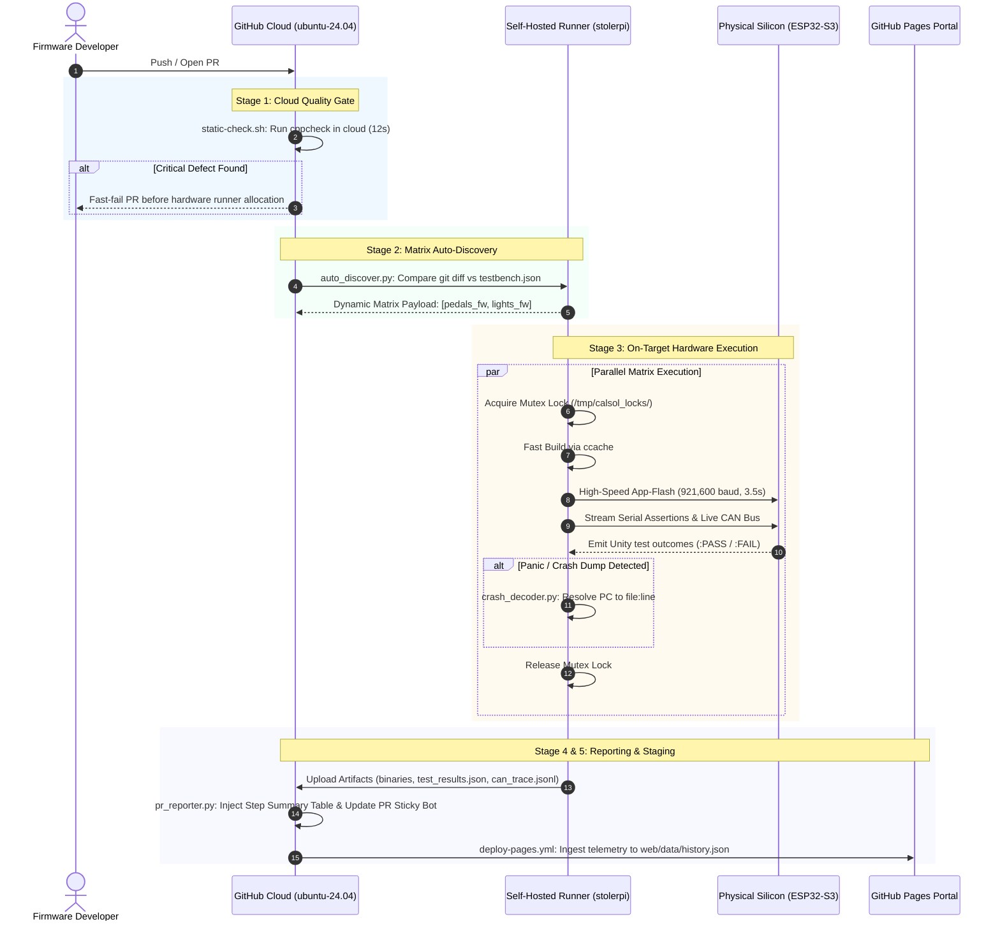

# CalSol Gen 11 Hardware-in-the-Loop (HIL) Testbench & CI Platform

[](https://github.com/JuneKim0712/CAN-Testbench/actions)


Continuous hardware integration, automated on-target silicon testing, and CAN bus telemetry validation for the UC Berkeley Solar Vehicle Team (**CalSol**).

This platform validates embedded vehicle firmware on physical microcontrollers and differential bus hardware before deployment to the Gen 11 solar car, serving both as the automated Hardware-in-the-Loop (HIL) test harness and as the reusable CI workflow engine for [`CalSol/Gen11-FW`](https://github.com/CalSol/Gen11-FW).

---

### Quick Links & Dashboards
* **Interactive Web Telemetry Portal:** [https://junekim0712.github.io/CAN-Testbench/](https://junekim0712.github.io/CAN-Testbench/)
* **Pedals / Brake Nominal Run (7/7 Passed):** [View `pedals_fw` Run](https://junekim0712.github.io/CAN-Testbench/?subsystem=pedals_fw&run=42325039593-pedals)
* **Lights Nominal Run (3/3 Passed):** [View `lights_fw` Run](https://junekim0712.github.io/CAN-Testbench/?subsystem=lights_fw&run=42325039593-lights)
* **GitHub Actions CI Dashboard:** [https://github.com/JuneKim0712/CAN-Testbench/actions](https://github.com/JuneKim0712/CAN-Testbench/actions)
* **Technical Architecture Manual:** [`docs/CODE_DOCUMENTATION.md`](docs/CODE_DOCUMENTATION.md)
* **Bench Operational Manual:** [`docs/CAN_TESTBENCH_STAGE_GUIDE.md`](docs/CAN_TESTBENCH_STAGE_GUIDE.md)

---

## Table of Contents
1. [System Overview & Architecture Topology](#1-system-overview--architecture-topology)
2. [Reusable GitHub Actions CI Integration Guide](#2-reusable-github-actions-ci-integration-guide)
   - [2.1 The 13-Line Reusable Workflow (`testbench.yml`)](#21-the-13-line-reusable-workflow-testbenchyml)
   - [2.2 Subsystem Configuration Manifest (`testbench.json`)](#22-subsystem-configuration-manifest-testbenchjson)
   - [2.3 Dynamic Change Detection & Auto-Discovery](#23-dynamic-change-detection--auto-discovery)
   - [2.4 Self-Hosted Runner Environment (`stolerpi`)](#24-self-hosted-runner-environment-stolerpi)
3. [CI Pipeline Stages & Execution Flow](#3-ci-pipeline-stages--execution-flow)
   - [3.1 End-to-End Pipeline Sequence](#31-end-to-end-pipeline-sequence)
   - [3.2 Stage Breakdown (Quality Gate, Discovery, Hardware Matrix, Reporting, Pages)](#32-stage-breakdown)
4. [Inspecting Test Results & Telemetry on GitHub](#4-inspecting-test-results--telemetry-on-github)
   - [4.1 Dedicated Step Summary Tables](#41-dedicated-step-summary-tables)
   - [4.2 Automated Crash Backtrace Decoding](#42-automated-crash-backtrace-decoding)
   - [4.3 Downloading Precompiled Trackside Binaries](#43-downloading-precompiled-trackside-binaries)
   - [4.4 Interactive Web Telemetry Portal](#44-interactive-web-telemetry-portal)
5. [Writing Subsystem Tests for CI](#5-writing-subsystem-tests-for-ci)
   - [5.1 Unit Test Writing Standards](#51-unit-test-writing-standards)
   - [5.2 Complete Test Suite Boilerplate](#52-complete-test-suite-boilerplate)
   - [5.3 CAN Frame Injection in Tests](#53-can-frame-injection-in-tests)
6. [CI Troubleshooting & Triage Matrix](#6-ci-troubleshooting--triage-matrix)
7. [Repository Layout](#7-repository-layout)
8. [Trackside Flashing & Safety Protocols](#8-trackside-flashing--safety-protocols)
9. [Complete Host & Hardware Setup Guide](#9-complete-host--hardware-setup-guide)
   - [9.1 Hardware Requirements & Wiring](#91-hardware-requirements--wiring)
   - [9.2 Host System Configuration (Linux / Raspberry Pi)](#92-host-system-configuration-linux--raspberry-pi)
   - [9.3 Software Toolchain & Environment](#93-software-toolchain--environment)

---

## 1. System Overview & Architecture Topology

The testbench operates on a dedicated physical host (`stolerpi` (Raspberry Pi 5)) directly wired to dual ESP32-S3 microcontroller nodes sharing a physical, differential 500 kbps CAN 2.0B bus:

```text
 ┌────────────────────────────────────────────────────────────────────────┐
 │                      Raspberry Pi 5 Host (stolerpi)                    │
 │                                                                        │
 │   ┌───────────────────────┐              ┌─────────────────────────┐   │
 │   │  HIL Test Runner      │              │  CAN Bridge Daemon      │   │
 │   │  (cal-test.sh)        │              │  (can_bridge_daemon.py) │   │
 │   └──────────┬────────────┘              └────────────┬────────────┘   │
 └──────────────┼────────────────────────────────────────┼────────────────┘
                │ USB CDC-ACM                            │ USB CDC-ACM
                ▼ (/dev/esp32_johnathan)                 ▼ (/dev/esp32_ahmed)
 ┌─────────────────────────────────┐        ┌─────────────────────────────┐
 │  Node 2: Device Under Test      │        │  Node 1: CAN Bus Debugger   │
 │  ESP32-S3 Microcontroller       │        │  ESP32-S3 Microcontroller   │
 │  TI TCAN332 CAN Transceiver     │        │  TI TCAN332 CAN Transceiver │
 └────────────────┬────────────────┘        └──────────────┬──────────────┘
                  │                                        │
                  ▼                                        ▼
 ══════════════════════════════════════════════════════════════════════════
               Physical CAN 2.0B Bus (500 kbps, 120Ω Terminated)
 ══════════════════════════════════════════════════════════════════════════
```

| Node | Physical Port Symlink | Role | Details |
| :--- | :--- | :--- | :--- |
| **Node 1** | `/dev/esp32_ahmed` | **CAN Bus Debugger** | Dedicated passive listener. Samples differential traffic at 500 kbps, decodes COBS frames, and broadcasts events to `/tmp/calsol_can.sock`. |
| **Node 2** | `/dev/esp32_johnathan` | **Device Under Test (DUT)** | Target node. Flashed on-the-fly with subsystem unit test firmware (`pedals_fw`, `lights_fw`). Evaluated for Unity assertions. |
| **Bus Backbone** | Differential Twisted Pair | **CAN 2.0B Vehicle Bus** | High-speed vehicle bus (500 kbps, 20 Time Quanta, 80% sample point) terminated with dual $120\,\Omega$ split termination resistors ($60\,\Omega$ equivalent). |

[↑ Back to top](#table-of-contents)

---

## 2. Reusable GitHub Actions CI Integration Guide

Follow this guide to connect any CalSol firmware repository (such as [`CalSol/Gen11-FW`](https://github.com/CalSol/Gen11-FW) or an individual ECU fork) to the automated hardware testbench.

### 2.1 The 13-Line Reusable Workflow (`testbench.yml`)

Add `.github/workflows/testbench.yml` to your firmware repository. This delegates all static analysis, matrix scheduling, and physical silicon flashing to the central testbench engine:

```yaml
name: CalSol Hardware CI

on:
  push:
    branches: [ main ]
  pull_request:
    branches: [ main ]
  workflow_dispatch:
    inputs:
      target:
        description: 'Target subsystem folder ("auto", "all", or explicit path)'
        required: false
        default: 'auto'
      port:
        description: 'Serial port override (optional, e.g. /dev/esp32_johnathan)'
        required: false
        default: ''

jobs:
  hardware-verification:
    name: Execute On-Target Hardware Testbench
    uses: CalSol/CAN_TestBench/.github/workflows/testbench.yml@main
    with:
      target: ${{ inputs.target || 'auto' }}
      port: ${{ inputs.port || '' }}
```

> [!TIP]
> The reusable workflow operates without modifying repository code. To test a single subsystem on demand, use the **Run workflow** dropdown in the GitHub Actions UI and specify the target folder name.

### 2.2 Subsystem Configuration Manifest (`testbench.json`)

The CI discovery engine scans the repository for `testbench.json` files. Add this manifest to the root of each ECU subsystem folder you want tested:

```json
{
  "name": "pedals_fw",
  "target": "pedals_fw/test",
  "port": "/dev/esp32_johnathan",
  "baud": 921600,
  "timeout": 15,
  "description": "Accelerator & Brake Plausibility Unit Tests"
}
```

#### Manifest Parameter Specifications:

| Parameter | Type | Default | Description |
| :--- | :---: | :---: | :--- |
| `name` | `string` | *(Required)* | Subsystem identifier, displayed across CI job matrices and web dashboards. |
| `target` | `string` | *(Required)* | Relative path to the ESP-IDF test project containing `CMakeLists.txt` and `main/`. |
| `port` | `string` | `""` | Dedicated microcontroller serial symlink on `stolerpi`. Set to `""` for automatic detection. |
| `baud` | `integer` | `921600` | Silicon flashing baud rate. 921,600 baud completes flashes in $< 3.5\,\text{s}$. |
| `timeout` | `integer` | `15` | Maximum seconds to wait for Unity test completion before timing out. |
| `description` | `string` | `""` | Human-readable explanation of subsystem safety rules and logic under test. |

### 2.3 Dynamic Change Detection & Auto-Discovery

The discovery engine ([`auto_discover.py`](file:///C:/JuneKim0712/CAN_TestBench/github-action/lib/auto_discover.py)) prevents unnecessary runner wear and queue congestion:
- **Pull Requests:** Evaluates `git diff --name-only origin/${GITHUB_BASE_REF}...HEAD`.
- **Pushes to `main`:** Evaluates `git diff --name-only HEAD~1 HEAD`.
- **Selective Matrix Scheduling:** If a PR only changes files in `pedals_fw/`, only `pedals_fw` is scheduled. Documentation changes cleanly skip hardware execution in 0 seconds.
- **Shared Dependency Propagation:** Modifications to shared components (`components/can_driver/` or runner scripts) automatically flag all registered subsystems as dirty, triggering a full monorepo verification sweep.

### 2.4 Self-Hosted Runner Environment (`stolerpi`)

The physical testbench runner operates on `stolerpi` (Raspberry Pi 5) as an isolated GitHub Actions Runner service:
- **Runner Labels:** Registered with tags `self-hosted`, `linux`, `ARM64`, and `stolerpi`.
- **Systemd Lingering Service:** Configured to stay online across system reboots without requiring an interactive shell:
  ```bash
  sudo loginctl enable-linger $USER
  ~/actions-runner/svc.sh install
  ~/actions-runner/svc.sh start
  ```
- **Repository Permissions:** In GitHub Repository Settings $\rightarrow$ Actions $\rightarrow$ General $\rightarrow$ Workflow permissions:
  - Select **Read and write permissions** (allows posting PR comments and writing Step Summaries).
  - Check **Allow GitHub Actions to create and approve pull requests**.

[↑ Back to top](#table-of-contents)

---

## 3. CI Pipeline Stages & Execution Flow

### 3.1 End-to-End Pipeline Sequence



### 3.2 Stage Breakdown

1. **Pre-Hardware Quality Gate (`static-analysis`):**  
   Runs `cppcheck` in an ephemeral cloud container (`ubuntu-24.04`). Verifies C/C++ memory safety, null-pointer dereferences, and buffer bounds. If a critical flaw is detected, CI fails in $< 15\,\text{s}$, preventing damaged or unstable code from reaching physical silicon.
2. **Subsystem Auto-Discovery (`discover`):**  
   Evaluates Git changes against `testbench.json` definitions and dynamically outputs a JSON matrix containing target paths, board ports, and timeout values.
3. **Hardware Matrix Execution (`testbench`):**  
   Dispatches parallel matrix jobs to `stolerpi`. Each job:
   - Acquires the hardware mutex lock `/tmp/calsol_locks/<board>.lock`.
   - Compiles firmware using `ccache` acceleration.
   - Flashes the target microcontroller via differential app-flash.
   - Streams serial output and decodes live CAN bus traffic via Node 1 (`/dev/esp32_ahmed`).
   - Captures any Guru Meditation crash dumps and resolves stack addresses to source lines.
   - Releases the hardware mutex lock.
4. **Consolidated Dashboard (`report`):**  
   Aggregates test assertion tables and failure diagnostics directly into `$GITHUB_STEP_SUMMARY` and posts a sticky status comment on the Pull Request.
5. **Interactive Telemetry Portal Deployment (`deploy-pages`):**  
   Ingests test result artifacts (`*_test_results.json`, `*_can_trace.jsonl`) into `web/data/history.json` and publishes to GitHub Pages.

[↑ Back to top](#table-of-contents)

---

## 4. Inspecting Test Results & Telemetry on GitHub

### 4.1 Dedicated Step Summary Tables

Every workflow execution produces a dedicated **Unit Test Assertions Breakdown table** inside GitHub Actions `$GITHUB_STEP_SUMMARY`:

| Status | Subsystem | Test Function | Location | Diagnostic Summary |
| :---: | :---: | :--- | :--- | :--- |
| `PASS` | `pedals_fw` | `test_throttle_calculation_and_deadzone` | `main/test_main.c:196` | Nominal mapping & saturation verified |
| `PASS` | `pedals_fw` | `test_brake_plausibility_safety_interlock` | `main/test_main.c:197` | FSAE 25% brake cutoff rule enforced |
| `PASS` | `pedals_fw` | `test_can_packet_builder_clamping_and_zeroing` | `main/test_main.c:198` | 8-byte clamping and zero-padding verified |
| `PASS` | `pedals_fw` | `test_can_driver_lifecycle` | `main/test_main.c:199` | Duplicate init protection verified |
| `PASS` | `pedals_fw` | `test_can_receive_timeout` | `main/test_main.c:200` | Non-blocking timeout confirmed |
| `PASS` | `pedals_fw` | `test_pedal_can_transmission` | `main/test_main.c:201` | Physical 10-packet sweep verified on bus |

### 4.2 Automated Crash Backtrace Decoding

When an unhandled exception or memory fault occurs on silicon, the ESP-IDF panic handler dumps raw register addresses to UART. The CI pipeline intercepts this dump, calls `xtensa-esp32s3-elf-addr2line`, and formats the decoded stack trace directly in GitHub Actions:

| Stack Frame | Program Counter (PC) | Function Name | Source Location |
| :---: | :---: | :--- | :--- |
| **#0** | `0x42008124` | `calculate_throttle_percent` | `pedals_fw/main/main.c:42` |
| **#1** | `0x4200845a` | `test_throttle_scaling` | `pedals_fw/test/main/test_main.c:68` |
| **#2** | `0x42001a18` | `app_main` | `pedals_fw/test/main/test_main.c:110` |

### 4.3 Downloading Precompiled Trackside Binaries

Every successful build archives trackside flashable binaries in the GitHub Run Artifacts:
- `<subsystem>_artifacts.zip` containing:
  - `<subsystem>.bin` (Application binary)
  - `bootloader.bin` (2nd stage bootloader)
  - `partition-table.bin` (ESP32 partition map)
  - `flasher_args.json` (esptool flash configuration)
  - `<subsystem>.elf` (Debug symbols for GDB / addr2line)

To download:
1. Navigate to your GitHub Actions workflow run.
2. Scroll to the **Artifacts** section at the bottom of the page.
3. Download the zipped artifact for immediate trackside flashing.

### 4.4 Interactive Web Telemetry Portal

Visit [`https://junekim0712.github.io/CAN-Testbench/`](https://junekim0712.github.io/CAN-Testbench/) to inspect:
- Multi-run comparative timelines across `pedals_fw` and `lights_fw`.
- High-resolution CAN timing waveforms and packet intervals.
- Bit-level payload inspection and signal decodes.

[↑ Back to top](#table-of-contents)

---

## 5. Writing Subsystem Tests for CI

### 5.1 Unit Test Writing Standards

To ensure compatibility with the CI serial parser:
1. Initialize serial and allow clock stabilization (`vTaskDelay(pdMS_TO_TICKS(1500));`).
2. Wrap all assertions inside `UNITY_BEGIN()` and `UNITY_END()`.
3. Use standard Unity assertion macros (`TEST_ASSERT_EQUAL`, `TEST_ASSERT_TRUE`, `TEST_ASSERT_FLOAT_WITHIN`).
4. Avoid blocking infinite loops without task delays.

### 5.2 Complete Test Suite Boilerplate

<details>
<summary><b>Click to expand complete test project boilerplate (CMake, Kconfig, & Unity C)</b></summary>

#### 1. `bms_fw/testbench.json`:
```json
{
  "name": "bms_fw",
  "target": "bms_fw/test",
  "port": "/dev/esp32_johnathan",
  "baud": 921600,
  "timeout": 15,
  "description": "Battery Management System Voltage & Thermal Interlock Assertions"
}
```

#### 2. `bms_fw/test/CMakeLists.txt`:
```cmake
cmake_minimum_required(VERSION 3.16)
include($ENV{IDF_PATH}/tools/cmake/project.cmake)
project(bms_fw_test)
```

#### 3. `bms_fw/test/main/CMakeLists.txt`:
```cmake
idf_component_register(SRCS "test_main.c"
                       INCLUDE_DIRS "."
                       REQUIRES unity can_driver)
```

#### 4. `bms_fw/test/sdkconfig.defaults`:
```ini
CONFIG_IDF_TARGET="esp32s3"
CONFIG_ESP_CONSOLE_UART_BAUDRATE=115200
```

#### 5. `bms_fw/test/main/test_main.c`:
```c
#include <stdio.h>
#include "unity.h"
#include "freertos/FreeRTOS.h"
#include "freertos/task.h"
#include "CAN.h"

static void test_undervoltage_cutoff(void) {
    uint16_t sample_mv = 2750; // 2.75V (below 2.8V cutoff)
    bool trip = (sample_mv < 2800);
    TEST_ASSERT_TRUE(trip);
}

void app_main(void) {
    vTaskDelay(pdMS_TO_TICKS(1500));
    UNITY_BEGIN();
    RUN_TEST(test_undervoltage_cutoff);
    UNITY_END();
}
```
</details>

### 5.3 CAN Frame Injection in Tests

The testbench supports live physical CAN message injection during unit test execution:

```c
static void test_bms_interlock_shutdown(void)
{
    TEST_ASSERT_EQUAL(ESP_OK, CAN_init());

    // Drain residual frames from prior tests
    CAN_message_t rx_msg = {0};
    while (CAN_receive(&rx_msg, 5) == ESP_OK) {}

    // Wait for frame injected via host daemon or test script
    esp_err_t err = CAN_receive(&rx_msg, 500);
    TEST_ASSERT_EQUAL(ESP_OK, err);
    TEST_ASSERT_EQUAL_HEX32(0x301, rx_msg.id);

    CAN_deinit();
}
```

To inject frames from the host terminal or a scripted test:
```bash
# Inject BMS Heartbeat (0x301):
python3 github-action/lib/calsol_inject.py --id 0x301 --data 02010058

# Inject 10 Hz motor controller frames:
python3 github-action/lib/calsol_inject.py --id 0x401 --data 000005DC --rate 10 --count 50
```

[↑ Back to top](#table-of-contents)

---

## 6. CI Troubleshooting & Triage Matrix

| Failure Symptom | Probable Root Cause | Resolution |
| :--- | :--- | :--- |
| **`Board is currently in use`** | Stale hardware lock file from a killed run. | Delete stale lock: `rm -f /tmp/calsol_locks/*.lock`. |
| **`Quality gate failed (cppcheck)`** | Memory leak, buffer overflow, or uninitialized pointer. | Run `./github-action/static-check.sh` locally and fix identified defects. |
| **`Flashing timed out / failed`** | Target MCU seized in panic loop or sleep state. | Force Download Mode: Hold **BOOT**, press **RESET**, release **BOOT**, re-run job. |
| **`Unity parser timed out (15s)`** | Firmware crashed before `UNITY_BEGIN()` or baud mismatch. | Check UART log: `cat github-action/.logs/*_serial.log`. Ensure baud rate is 115,200. |
| **`Subsystem skipped in CI`** | Missing `testbench.json` or no modified files in PR delta. | Ensure `testbench.json` is committed in subsystem root. Check `git diff origin/main...HEAD`. |
| **`Permission denied: /dev/ttyACM*`** | Self-hosted runner missing `dialout` group access. | Run `sudo usermod -a -G dialout $USER` and restart runner service. |

[↑ Back to top](#table-of-contents)

---

## 7. Repository Layout

```text
CAN_TestBench/
├── .github/
│   └── workflows/
│       ├── unit-test.yml           # Monorepo CI workflow (push, PR, dispatch)
│       ├── deploy-pages.yml        # Continuous deployment to GitHub Pages
│       └── testbench.yml           # Reusable workflow for external ECU repositories
│
├── components/                     # Shared vehicle components (synchronized with Gen11-FW)
│   └── can_driver/                 # Universal TWAI/CAN driver (CAN.h, CAN_driver.c)
│
├── pedals_fw/                      # Subsystem: Accelerator & Brake Plausibility
│   ├── testbench.json              # HIL hardware testbench specification
│   ├── main/                       # Operational subsystem firmware
│   └── test/                       # Unity on-target test suite
│
├── lights_fw/                      # Subsystem: Brakelights & Hazards
│   ├── testbench.json              # HIL hardware testbench specification
│   ├── main/                       # Operational subsystem firmware
│   └── test/                       # Unity on-target test suite
│
├── sim/                            # Software Vehicle Simulation & Emulation
│   └── virtual_ecus/               # Software-defined mock ECUs (BMS, Motor, Steering)
│
├── docs/                           # Hardware architectural & stage guides
│   ├── CODE_DOCUMENTATION.md       # Complete code & architectural reference manual
│   └── CAN_TESTBENCH_STAGE_GUIDE.md # Stage-by-stage operational & engineering manual
│
├── web/                            # Interactive Telemetry Web Portal (GitHub Pages)
│   ├── index.html                  # Minimalist telemetry dashboard
│   └── data/
│       └── history.json            # Cumulative testbench run records & bus traces
│
└── github-action/                  # CI runner scripts & telemetry ingestion libraries
    ├── action.yml                  # Standalone GitHub Composite Action definition
    ├── cal-test.sh                 # Master test execution runner (build, flash, parse, report)
    ├── cal-flash.sh                # Standalone safe firmware flashing tool
    ├── static-check.sh             # Cloud static analysis & quality gate runner
    └── lib/
        ├── auto_discover.py        # Subsystem discovery & git change resolver
        ├── unity_parser.py         # Serial parser, test evaluator, and step summary writer
        ├── can_bridge_daemon.py    # Host CAN ingestion daemon & socket server
        ├── crash_decoder.py        # ESP32 panic register & stack backtrace decoder
        ├── pages_compiler.py       # Ingests telemetry & compiles web/data/history.json
        ├── pr_reporter.py          # Consolidated test dashboard & PR comment reporter
        ├── calsol_snoop.py         # CLI live CAN bus snooper tool
        └── calsol_inject.py        # CLI CAN frame injector tool
```

[↑ Back to top](#table-of-contents)

---

## 8. Trackside Flashing & Safety Protocols

Precompiled firmware binaries (`.bin`, `.elf`, `bootloader.bin`) are automatically archived in GitHub Run Artifacts on every build.

### Trackside Single-Command Flashing:
```bash
python3 -m esptool --chip esp32s3 -p /dev/esp32_johnathan -b 921600 write_flash 0x10000 pedals_fw.bin
```

### High-Voltage DC & Bus Safety Protocols:
1. **DC Voltage Isolation:** Ensure the high-voltage traction pack is isolated and safety interlocks are disengaged before touching ECU transceivers.
2. **Split Termination Verification:** Never operate the vehicle bus without both $120\,\Omega$ termination resistors installed (equivalent resistance must be $60\,\Omega$).
3. **Common Ground:** Maintain a common ground reference between the host testbench and the ECU ground plane to prevent ground loop damage.

[↑ Back to top](#table-of-contents)

---

## 9. Complete Host & Hardware Setup Guide

Follow this guide to commission a new engineering laptop or Raspberry Pi lab runner from scratch.

### 9.1 Hardware Requirements & Wiring

1. **Microcontrollers & Transceivers:**
   - 2x ESP32-S3 DevKits (ESP32-S3-WROOM-1).
   - 2x TI TCAN332 (or ISO 11898-2 compatible 3.3V CAN transceivers).
2. **Pin Assignments (Both Nodes):**
   - `GPIO 17` $\rightarrow$ Transceiver **TXD**
   - `GPIO 18` $\rightarrow$ Transceiver **RXD**
   - `3.3V` & `GND` $\rightarrow$ Transceiver Power
3. **Differential Bus Wiring:**
   - Connect Node 1 **CAN_H** to Node 2 **CAN_H**.
   - Connect Node 1 **CAN_L** to Node 2 **CAN_L**.
   - Install a $120\,\Omega$, 1/4W resistor across CAN_H and CAN_L at both physical ends of the twisted pair.

> [!CAUTION]
> Always verify bus resistance with power disconnected before connecting microcontrollers. Measure resistance between CAN_H and CAN_L. The multimeter must read $60\,\Omega \pm 3\,\Omega$. Powering the bus without split termination can damage transceiver input stages.

---

### 9.2 Host System Configuration (Linux / Raspberry Pi)

To ensure persistent device names regardless of USB plug order, configure custom `udev` rules:

1. **Create the udev rule file:**
   ```bash
   sudo nano /etc/udev/rules.d/99-calsol-hil.rules
   ```

2. **Add the persistent symlinks (matched by USB vendor/product IDs or serials):**
   ```udev
   # Node 1: CAN Bus Debugger (/dev/esp32_ahmed)
   SUBSYSTEM=="tty", ATTRS{idVendor}=="303a", ATTRS{idProduct}=="1001", ATTRS{serial}=="AHMED_*", SYMLINK+="esp32_ahmed", MODE="0666"

   # Node 2: Device Under Test (/dev/esp32_johnathan)
   SUBSYSTEM=="tty", ATTRS{idVendor}=="303a", ATTRS{idProduct}=="1001", ATTRS{serial}=="JOHNATHAN_*", SYMLINK+="esp32_johnathan", MODE="0666"
   ```

3. **Reload rules and add your user to the serial groups:**
   ```bash
   sudo udevadm control --reload-rules
   sudo udevadm trigger
   sudo usermod -a -G dialout,plugdev $USER
   ```
   *(Log out and log back in for group permissions to take effect)*.

4. **Verify device detection:**
   ```bash
   ls -la /dev/esp32_*
   # Expected output:
   # lrwxrwxrwx 1 root root /dev/esp32_ahmed -> ttyACM0
   # lrwxrwxrwx 1 root root /dev/esp32_johnathan -> ttyACM1
   ```

---

### 9.3 Software Toolchain & Environment

1. **Clone the repository:**
   ```bash
   git clone https://github.com/CalSol/CAN_TestBench.git
   cd CAN_TestBench
   ```

2. **Install system utilities:**
   ```bash
   sudo apt-get update
   sudo apt-get install -y git python3 python3-pip python3-venv ccache cppcheck
   ```

3. **Install Python host dependencies:**
   ```bash
   pip3 install --user pyserial
   ```

4. **Install and Source ESP-IDF (v5.1+ or v5.3+ recommended):**
   ```bash
   # If ESP-IDF is not yet installed:
   mkdir -p ~/esp && cd ~/esp
   git clone --recursive https://github.com/espressif/esp-idf.git -b v5.3.1
   cd esp-idf && ./install.sh esp32s3

   # Export environment to current shell:
   . ~/esp/esp-idf/export.sh
   ```
   *(Verify installation by typing `idf.py --version`)*.

[↑ Back to top](#table-of-contents)
