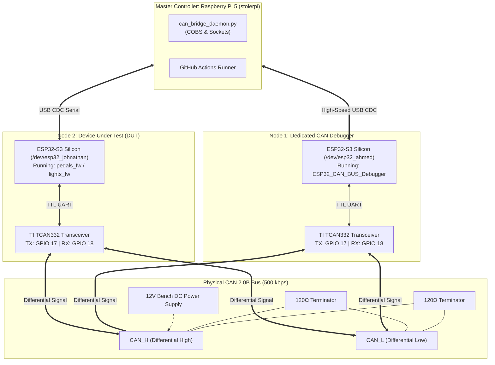
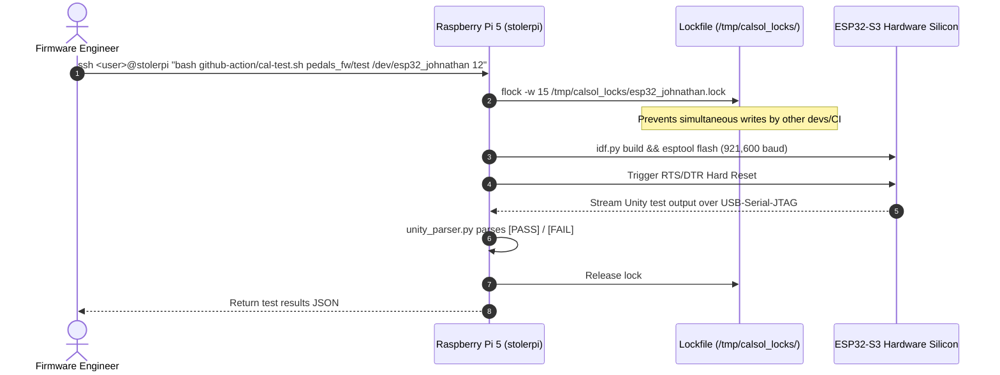
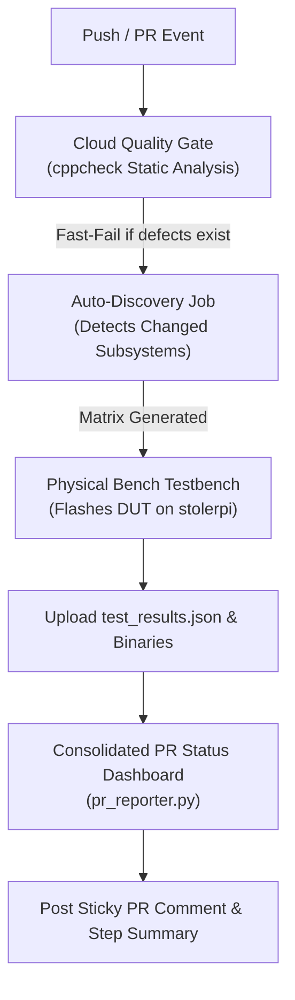

# CalSol Hardware CAN Testbench: Stage-by-Stage Operational & Engineering Manual

This manual is the definitive, beginner-accessible guide to the **CalSol Hardware-in-the-Loop (HIL) CAN Testbench**. It explains how the entire system works—from physical silicon and wiring to cloud continuous integration—broken down into clear, progressive stages. 

Whether you are a new firmware developer writing your first driver or a test engineer evaluating vehicle safety, this guide provides the concepts, architectural diagrams, and step-by-step commands needed to operate the bench without prior knowledge of the codebase.

> **Technical Reference:** For detailed function signatures, struct layouts, FreeRTOS queue mechanics, and script internals, refer to the [Code & Architecture Reference Manual](CODE_DOCUMENTATION.md).

---

## Table of Contents
1. [System Overview & Philosophy](#1-system-overview--philosophy)
2. [Stage 1: Physical Hardware & Bench Architecture](#stage-1-physical-hardware--bench-architecture)
3. [Stage 2: Remote Flashing & Interactive Serial Monitoring](#stage-2-remote-flashing--interactive-serial-monitoring)
4. [Stage 3: Remote CAN Packet Snooping & Injection](#stage-3-remote-can-packet-snooping--injection)
5. [Stage 4: Software Board Emulation (Virtual ECUs)](#stage-4-software-board-emulation-virtual-ecus)
6. [Stage 5: GitHub Actions CI Pipeline & PR Status Dashboard](#stage-5-github-actions-ci-pipeline--pr-status-dashboard)
7. [Stage 6: Developer & Operator Quick Reference Cheat Sheet](#stage-6-developer--operator-quick-reference-cheat-sheet)

---

## 1. System Overview & Philosophy

### The Engineering Challenge
Developing solar vehicle firmware is difficult without access to a physical car or lab desk. In traditional workflows:
- Firmware is written on personal laptops without physical verification.
- Code breaks when flashed to real microcontrollers because silicon timing and register behavior differ from laptop CPUs.
- Missing vehicle subsystems (such as the Battery Management System or Motor Controller) prevent standalone testing of individual nodes like the pedal or lights board.

### The Solution: The CalSol Testbench
The **CalSol CAN Testbench** bridges this gap. Hosted on a dedicated Raspberry Pi 5 (`stolerpi`), it creates an automotive proving ground combining:
1. **Real Hardware:** Physical ESP32-S3 microcontrollers connected to real differential CAN transceivers.
2. **Remote Access:** Firmware flashing and terminal monitoring over the secure Tailscale mesh network.
3. **Dedicated Bus Debugger:** Real-time hardware snooping and injection running [ESP32_CAN_BUS_Debugger](https://github.com/CalSol/ESP32_CAN_BUS_Debugger).
4. **Software Vehicle Simulation:** Realistic virtual vehicle models (Virtual BMS, Virtual Motor, Virtual Steering) that fill in for missing car hardware.
5. **Continuous Verification:** Automated on-target compilation, device flashing, and Unity test verification on every GitHub Pull Request.

---

## Stage 1: Physical Hardware & Bench Architecture

The testbench is structured into three distinct hardware tiers: the **Master Controller**, the **Physical CAN Backbone**, and the **Microcontroller Nodes**.



### Hardware Inventory & Device Mapping
- **Raspberry Pi 5 (`stolerpi` @ `100.120.92.102`):** Quad-core ARM Cortex-A76 host running Linux. Manages all compilation, flashing, bridge daemon, and network sockets.
- **Node 1 (CAN Debugger):** Permanent symlink `/dev/esp32_ahmed` (MAC `E0:72:A1:FD:24:38`). Dedicated sniffer/injector running `ESP32_CAN_BUS_Debugger`.
- **Node 2 (DUT):** Permanent symlink `/dev/esp32_johnathan` (MAC `E0:72:A1:FC:DC:94`). Test target flashed on-demand with firmware under review (`pedals_fw` / `lights_fw`).
- **Transceivers (TI TCAN332):** Convert 3.3V logic to high-speed differential CAN voltages ($CAN\_H \approx 3.5V$, $CAN\_L \approx 1.5V$). Silicon pinout is **TX = GPIO 17**, **RX = GPIO 18**.
- **Bus Termination:** Two 120Ω resistors at each bus end to prevent signal reflection.

---

## Stage 2: Remote Flashing & Interactive Serial Monitoring

Firmware engineers do not need to sit next to the bench or touch cables. Flashing and monitoring are fully automated via the host scripts.



### Concurrency Protection (Mutex Locks)
To prevent two engineers or a GitHub Actions runner from flashing the same microcontroller at the same moment, the testbench enforces Linux kernel advisory locks (`flock`):
- Locks live in `/tmp/calsol_locks/<device>.lock`.
- If a port is in use, incoming requests wait up to 15 seconds before safely failing with an informative diagnostic message rather than corrupting flash memory.

### How to Flash & Test a Board
From your workstation terminal:
```bash
# 1. Connect and run automated Unity unit tests on Node 2 (DUT)
ssh <user>@stolerpi "bash ~/actions-runner/_work/CAN-Testbench/CAN-Testbench/github-action/cal-test.sh pedals_fw/test /dev/esp32_johnathan 15"

# 2. Flash standalone firmware binary without running Unity tests
ssh <user>@stolerpi "bash ~/actions-runner/_work/CAN-Testbench/CAN-Testbench/github-action/cal-flash.sh pedals_fw/test /dev/esp32_johnathan"
```

---

## Stage 3: Remote CAN Packet Snooping & Injection

The bench operates a high-speed software bridge daemon ([`can_bridge_daemon.py`](../github-action/lib/can_bridge_daemon.py)) that interfaces with the dedicated CAN Debugger on Node 2.

```mermaid
flowchart LR
    subgraph Silicon ["CAN Bus Wire"]
        Wire["Physical Differential Bus (500 kbps)"]
    end

    subgraph Node2 ["ESP32 CAN Debugger"]
        FW["ESP32_CAN_BUS_Debugger<br/>COBS Wire Protocol"]
    end

    subgraph DaemonTier ["Daemon Layer (stolerpi)"]
        Daemon["can_bridge_daemon.py"]
        Trace[("/tmp/can_trace.jsonl")]
        Sock[("/tmp/calsol_can.sock<br/>or TCP: 5555")]
    end

    subgraph Clients ["Remote Clients"]
        Snoop["calsol_snoop.py<br/>(Live Waterfall)"]
        Inject["calsol_inject.py<br/>(Packet Injector)"]
        VirtualCar["car_runner.py<br/>(Vehicle Simulation)"]
    end

    Wire <===>|Differential| FW
    FW <===>|USB CDC Stream (COBS)| Daemon
    Daemon --> Trace
    Daemon <===> Sock
    Sock <===> Snoop
    Sock <===> Inject
    Sock <===> VirtualCar
```

### The COBS Wire Protocol
Because CAN frames can contain arbitrary binary zeros (`0x00`), standard null-terminated serial streams would break. The debugger uses **Consistent Overhead Byte Stuffing (COBS)**:
- Encodes arbitrary payloads so that `0x00` never appears within a frame body.
- Appends `0x00` strictly as a frame boundary delimiter.
- Computes an 8-bit checksum: `sum(frame) % 256 == 0` for integrity.

### How to Snoop (Listen to) Live Bus Traffic
Run [`calsol_snoop.py`](../github-action/lib/calsol_snoop.py) to watch the live bus in real-time:
```bash
# Snoop on the Raspberry Pi
python3 github-action/lib/calsol_snoop.py

# Snoop remotely from your laptop over Tailscale
python3 github-action/lib/calsol_snoop.py --tcp 100.120.92.102:5555

# Filter for a specific CAN ID (e.g. 0x501 Drive Command)
python3 github-action/lib/calsol_snoop.py --id 0x501
```
**Example Live Terminal Output:**
```text
Timestamp      Dir  CAN ID  DLC  Payload Data
-------------------------------------------------------
[03:12:45.102]  RX   0x301    8    02 01 00 58 00 00 00 00
[03:12:45.150]  RX   0x502    8    05 DC 01 C2 00 24 01 5E
[03:12:45.201]  TX   0x200    8    01 00 02 00 00 00 00 00
```

### How to Inject (Transmit) Packets Remotely
Run [`calsol_inject.py`](../github-action/lib/calsol_inject.py) to transmit custom CAN frames:
```bash
# One-shot injection of Drive Command 0x501
python3 github-action/lib/calsol_inject.py --id 0x501 --data 000000003F000000

# Continuous injection at 20 Hz (e.g. simulating accelerator pedal)
python3 github-action/lib/calsol_inject.py --id 0x11 --data 80 --rate 20
```

---

## Stage 4: Software Board Emulation (Virtual ECUs)

When developing a single subsystem (like the pedals board), the other physical car ECUs (BMS, Motor Controller, Steering) are usually missing. The testbench provides lightweight, deterministic software-defined mock ECUs in [`sim/virtual_ecus/`](../sim/virtual_ecus/).

### The Emulated Models
1. **Virtual BMS ([`virtual_bms.py`](../sim/virtual_ecus/virtual_bms.py)):**
   - Simulates a 96-cell series lithium-ion pack (nominal 379.2V, 28.5°C, 88% SoC).
   - Broadcasts Heartbeat `0x301` @ 10 Hz, Cell Voltages `0x302` @ 2 Hz, Temperatures `0x303` @ 1 Hz.
   - Responds to fault conditions by tripping contactors from `CLOSED` to `OPEN`.
2. **Virtual Motor Controller ([`virtual_motor.py`](../sim/virtual_ecus/virtual_motor.py)):**
   - Simulates a Tritium WaveSculptor 22 motor controller and Gen11 vehicle physics ($320\text{ kg}$, $C_d A = 0.12$, $C_{rr} = 0.0028$, $80\text{ Nm}$ peak torque).
   - Listens for Drive Command `0x501` or Pedal Position `0x11`.
   - Broadcasts Motor Status `0x502` @ 20 Hz (RPM, velocity, phase current) and Bus Measurements `0x503` @ 10 Hz.
3. **Virtual Steering ([`virtual_steering.py`](../sim/virtual_ecus/virtual_steering.py)):**
   - Simulates driver mode switch (`NEUTRAL`, `DRIVE`, `REVERSE`), cruise control, and hazard lights.
   - Broadcasts Controls `0x200` @ 10 Hz.

### Running the Virtual Vehicle
To bring up the entire simulated vehicle in the background:
```bash
# Start all virtual ECUs on the Pi
python3 sim/virtual_ecus/car_runner.py

# Run for a fixed duration (e.g. 30 seconds for test automation)
python3 sim/virtual_ecus/car_runner.py --duration 30
```

---

## Stage 5: GitHub Actions CI Pipeline & PR Status Dashboard

On every Pull Request or push to `main`, GitHub Actions automatically orchestrates the entire verification process via [`.github/workflows/unit-test.yml`](../.github/workflows/unit-test.yml).



### The Pipeline Gates:
1. **Cloud Lint & Static Analysis Gate (`static-analysis`):** Runs on Ubuntu Cloud in 13 seconds. Fast-fails if syntax errors, null pointers, or memory leaks are detected before touching physical hardware.
2. **Subsystem Auto-Discovery (`discover`):** Runs on `stolerpi`. Analyzes git diff against `main`. If only `pedals_fw` was modified, it dispatches only `pedals_fw` tests, skipping unaffected boards.
3. **Hardware Execution Matrix (`testbench`):** Compiles firmware using ESP-IDF v6.1 and Ninja, acquires the device mutex lock, flashes the microcontroller at 921,600 baud, and monitors Unity assertions.
4. **Consolidated Dashboard Bot (`report`):** Downloads test reports and crash dumps, compiling a clean Markdown summary into GitHub Actions `$GITHUB_STEP_SUMMARY` and posting an interactive sticky comment on the PR.

---

## Stage 6: Developer & Operator Quick Reference Cheat Sheet

### Common Operator Commands

| Task | Command |
| :--- | :--- |
| **Snoop Bus Traffic** | `python3 github-action/lib/calsol_snoop.py` |
| **Snoop Remotely (from laptop)** | `python3 github-action/lib/calsol_snoop.py --tcp 100.120.92.102:5555` |
| **Inject Single Packet** | `python3 github-action/lib/calsol_inject.py --id 0x501 --data DEADBEEF` |
| **Inject Periodic Packet (20 Hz)** | `python3 github-action/lib/calsol_inject.py --id 0x11 --data 80 --rate 20` |
| **Start Virtual Vehicle** | `python3 sim/virtual_ecus/car_runner.py` |
| **Run Unit Tests on DUT** | `ssh <user>@stolerpi "bash ~/actions-runner/_work/CAN-Testbench/CAN-Testbench/github-action/cal-test.sh pedals_fw/test /dev/esp32_johnathan 15"` |
| **Flash DUT Standalone** | `ssh <user>@stolerpi "bash ~/actions-runner/_work/CAN-Testbench/CAN-Testbench/github-action/cal-flash.sh pedals_fw/test /dev/esp32_johnathan"` |
| **Restore Debugger to Node 1** | `ssh <user>@stolerpi "python3 -m esptool --chip esp32s3 -p /dev/esp32_ahmed -b 921600 write-flash 0x0 /opt/calsol/ESP32_CAN_BUS_Debugger/build_dev/bootloader/bootloader.bin 0x8000 /opt/calsol/ESP32_CAN_BUS_Debugger/build_dev/partition_table/partition-table.bin 0x10000 /opt/calsol/ESP32_CAN_BUS_Debugger/build_dev/CAN_driver_API.bin"` |

---

### Troubleshooting Checklist
- **Serial port permission denied:** Ensure user is in `dialout` group (`sudo usermod -aG dialout <user>`).
- **Device locked error:** Check `/tmp/calsol_locks/` on `stolerpi`. If an orphaned process crashed, remove the stale `.lock` file.
- **Bus off / Transmit error count rising:** Verify that the 12V bench DC power supply is active and connected to transceiver $V_{CC}$ / differential bias pins.
- **No CAN frames appearing in snooper:** Check that `can_bridge_daemon.py` is running (`pgrep -f can_bridge_daemon.py`). If not, launch it with `python3 github-action/lib/can_bridge_daemon.py &`.
