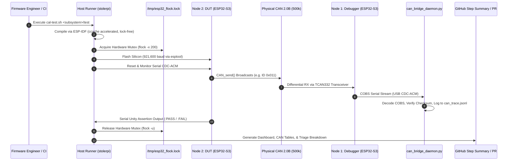
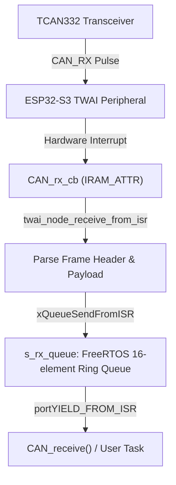
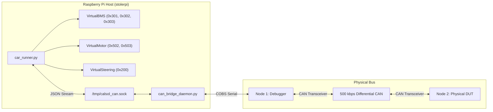
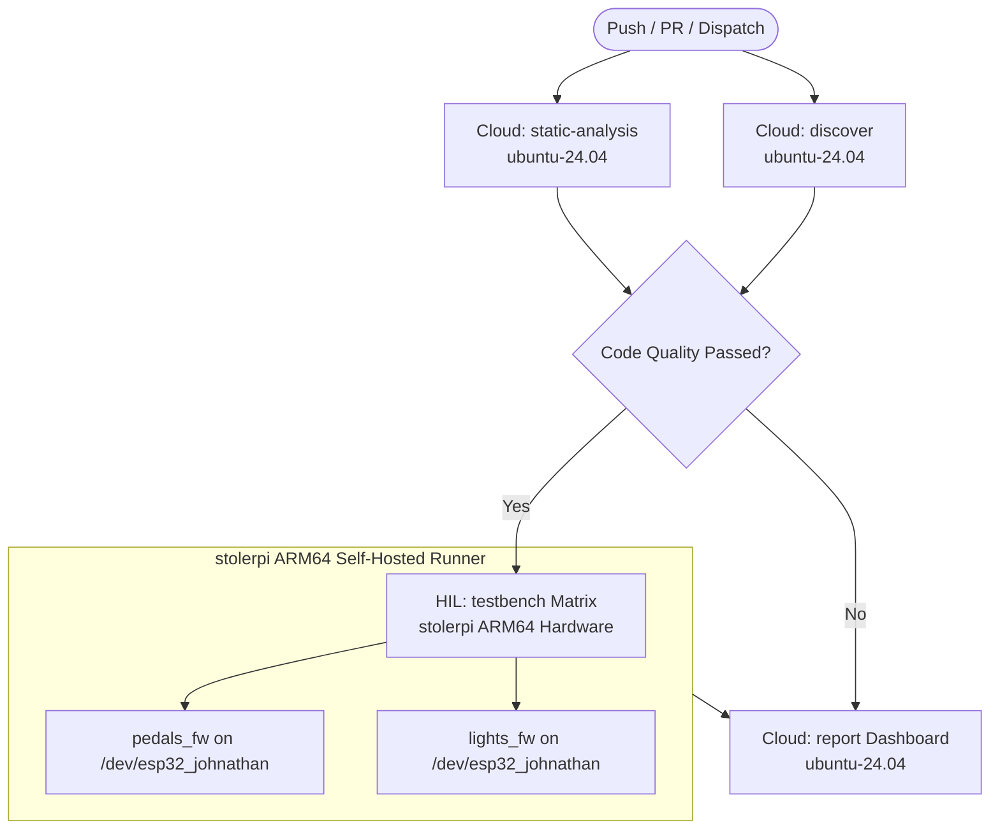

# CalSol Gen 11 Hardware Testbench: Code & Architecture Reference Manual

Continuous hardware integration, automated on-target silicon testing, software-defined vehicle simulation, and CAN bus telemetry analysis for the UC Berkeley Solar Vehicle Team (**CalSol**).

This document is the technical reference for the codebase in [`CalSol/CAN_TestBench`](https://github.com/CalSol/CAN_TestBench). It provides an in-depth, code-level explanation of every module, driver, daemon, test suite, and CI automation script in the repository.

> **Quick Links:**
> - **Interactive Web Telemetry Dashboard:** [https://junekim0712.github.io/CAN-Testbench/](https://junekim0712.github.io/CAN-Testbench/)
> - **Front-Page Setup, Test & Debugging Manual:** [`../README.md`](../README.md)
> - **Stage-by-Stage Walkthrough:** [`CAN_TESTBENCH_STAGE_GUIDE.md`](CAN_TESTBENCH_STAGE_GUIDE.md)

---

## Table of Contents
1. [System Architecture & Dataflow](#1-system-architecture--dataflow)
2. [CAN Driver Component (`components/can_driver`)](#2-can-driver-component-componentscan_driver)
   - [2.1 Header Interface (`CAN.h`)](#21-header-interface-canh)
   - [2.2 Implementation (`CAN_driver.c`)](#22-implementation-can_driverc)
   - [2.3 Hardware Interrupts & Queue Mechanics](#23-hardware-interrupts--queue-mechanics)
3. [ECU Subsystems & On-Target Test Suites](#3-ecu-subsystems--on-target-test-suites)
   - [3.1 Pedals Subsystem (`pedals_fw`)](#31-pedals-subsystem-pedals_fw)
   - [3.2 Lights Subsystem (`lights_fw`)](#32-lights-subsystem-lights_fw)
   - [3.3 Manifest Specification (`testbench.json`)](#33-manifest-specification-testbenchjson)
4. [Software Vehicle Simulation (`sim/virtual_ecus`)](#4-software-vehicle-simulation-simvirtual_ecus)
   - [4.1 Virtual BMS (`virtual_bms.py`)](#41-virtual-bms-virtual_bmspy)
   - [4.2 Virtual Motor Controller (`virtual_motor.py`)](#42-virtual-motor-controller-virtual_motorpy)
   - [4.3 Virtual Steering Wheel (`virtual_steering.py`)](#43-virtual-steering-wheel-virtual_steeringpy)
   - [4.4 Simulation Orchestrator (`car_runner.py`)](#44-simulation-orchestrator-car_runnerpy)
5. [Host Testbench Runner & Execution Scripts (`github-action/`)](#5-host-testbench-runner--execution-scripts-github-action)
   - [5.1 Master Test Runner (`cal-test.sh`)](#51-master-test-runner-cal-testsh)
   - [5.2 Safe Flashing Utility (`cal-flash.sh`)](#52-safe-flashing-utility-cal-flashsh)
   - [5.3 Terminal Bus Monitor (`cal-snoop.sh`)](#53-terminal-bus-monitor-cal-snoopsh)
   - [5.4 Static Analysis Runner (`static-check.sh`)](#54-static-analysis-runner-static-checksh)
   - [5.5 GitHub Composite Action (`action.yml`)](#55-github-composite-action-actionyml)
6. [Python Ingestion, Analytics & Reporting Engines (`github-action/lib/`)](#6-python-ingestion-analytics--reporting-engines-github-actionlib)
   - [6.1 Subsystem Auto-Discovery (`auto_discover.py`)](#61-subsystem-auto-discovery-auto_discoverpy)
   - [6.2 CAN Bridge Daemon (`can_bridge_daemon.py`)](#62-can-bridge-daemon-can_bridge_daemonpy)
   - [6.3 Real-Time Unity Serial Parser (`unity_parser.py`)](#63-real-time-unity-serial-parser-unity_parserpy)
   - [6.4 Guru Meditation Panic Decoder (`crash_decoder.py`)](#64-guru-meditation-panic-decoder-crash_decoderpy)
   - [6.5 Unified CI Status Reporter (`pr_reporter.py`)](#65-unified-ci-status-reporter-pr_reporterpy)
   - [6.6 CLI Snooping & Injection Clients (`calsol_snoop.py`, `calsol_inject.py`)](#66-cli-snooping--injection-clients-calsol_snooppy-calsol_injectpy)
7. [Continuous Integration Pipelines (`.github/workflows/`)](#7-continuous-integration-pipelines-githubworkflows)
   - [7.1 Monorepo CI Pipeline (`unit-test.yml`)](#71-monorepo-ci-pipeline-unit-testyml)
   - [7.2 Reusable External Workflow (`testbench.yml`)](#72-reusable-external-workflow-testbenchyml)
8. [Wire Protocols & Schemas](#8-wire-protocols--schemas)
9. [Developer Guide & Extensibility](#9-developer-guide--extensibility)

---

## 1. System Architecture & Dataflow

The CalSol Hardware-in-the-Loop (HIL) Testbench links software firmware repositories to physical vehicle electronics. It operates on a dedicated Raspberry Pi 5 (`stolerpi`) host connected to physical microcontroller nodes and a 500 kbps differential CAN 2.0B bus.



### Physical Node Configuration

| Node | Device Symlink | Silicon / Core | Transceiver | Role |
| :--- | :--- | :--- | :--- | :--- |
| **Node 1** | `/dev/esp32_ahmed` | ESP32-S3 (Xtensa Dual-Core 240MHz) | TI TCAN332 | **CAN Bus Debugger:** Listens to raw differential bus traffic, packages frames in COBS, bridges to host Unix socket `/tmp/calsol_can.sock`. |
| **Node 2** | `/dev/esp32_johnathan` | ESP32-S3 (Xtensa Dual-Core 240MHz) | TI TCAN332 | **Device Under Test (DUT):** Dynamic target flashed with subsystem firmware (`pedals_fw`, `lights_fw`). Runs Unity unit tests on-target. |
| **Bus Backbone** | Differential Twisted Pair | N/A | 120 Ω Termination | Physical CAN 2.0B bus running at 500,000 bps with dual split-termination resistors. |

---

## 2. CAN Driver Component (`components/can_driver`)

The `can_driver` component provides the core hardware abstraction layer (HAL) for CAN 2.0B communication on the ESP32-S3 using Espressif's TWAI (Two-Wire Automotive Interface) driver.

### 2.1 Header Interface (`CAN.h`)

Located at [`components/can_driver/CAN.h`](file:///C:/JuneKim0712/CAN_TestBench/components/can_driver/CAN.h).

#### Pin Definitions
```c
#define CAN_TX GPIO_NUM_17
#define CAN_RX GPIO_NUM_18
```
- Maps the internal TWAI controller TX/RX signals to the onboard TI TCAN332 3.3V CAN transceiver.

#### Data Structures
```c
typedef struct {
    uint32_t id;         // 11-bit standard ID or 29-bit extended ID
    uint8_t  dlc;        // Data Length Code (0 to 8 bytes)
    uint8_t  data[8];    // Payload byte buffer
    bool     extended;   // True if 29-bit extended frame (IDE bit = 1)
    bool     rtr;        // Remote Transmission Request bit
} CAN_message_t;
```

#### Exported Functions

```c
esp_err_t CAN_init(void);
```
Initializes the on-chip TWAI peripheral at 500 kbps, allocates an internal FreeRTOS ring queue (capacity: 16 frames), registers the ISR callback, and transitions the TWAI node into the online/active state. Enables `flags.enable_self_test = 1` allowing loopback validation on benches lacking secondary active nodes.
- **Returns:** `ESP_OK` on success; `ESP_ERR_INVALID_STATE` if already initialized; `ESP_ERR_NO_MEM` if queue allocation fails.

```c
esp_err_t CAN_deinit(void);
```
Stops the TWAI node, deletes the FreeRTOS receive queue, unregisters driver callbacks, and frees peripheral memory.
- **Returns:** `ESP_OK` on success; `ESP_ERR_INVALID_STATE` if the driver was not initialized.

```c
esp_err_t CAN_send(const CAN_message_t *frame, uint32_t timeout_ms);
```
Marshals a `CAN_message_t` into an Espressif `twai_frame_t`, formats a structured telemetry log (`[CAN_FRAME] ID:0x... DLC:... DATA:...`), queues the frame for transmission, and blocks until all pending frames are flushed out of the hardware TX FIFO buffer.
- **Parameters:**
  - `frame`: Pointer to the frame struct to transmit.
  - `timeout_ms`: Maximum wait duration in milliseconds.
- **Returns:** `ESP_OK` on successful transmission; `ESP_ERR_INVALID_STATE` if driver uninitialized; `ESP_ERR_TIMEOUT` on queue saturation.

```c
esp_err_t CAN_receive(CAN_message_t *frame, uint32_t timeout_ms);
```
Pulls the next received frame from the FreeRTOS RX queue.
- **Parameters:**
  - `frame`: Destination buffer for the received frame.
  - `timeout_ms`: Maximum wait time in milliseconds (`0xFFFFFFFF` for infinite blocking).
- **Returns:** `ESP_OK` on reception; `ESP_ERR_INVALID_STATE` if driver not initialized; `ESP_ERR_INVALID_ARG` if `frame == NULL`; `ESP_ERR_TIMEOUT` if no message arrives within `timeout_ms`.

```c
CAN_message_t build_packet_no_ext(uint32_t id, const uint8_t *data, uint8_t dlc);
```
Constructs a standard 11-bit data frame (`extended = false`, `rtr = false`). Clamps `dlc` to 8 if greater than 8, defaults to 8 if 0, copies payload data, and zeros all trailing bytes.

```c
twai_node_handle_t CAN_get_node_handle(void);
```
Returns the underlying Espressif `twai_node_handle_t` for low-level driver inspection or power management.

---

### 2.2 Implementation (`CAN_driver.c`)

Located at [`components/can_driver/CAN_driver.c`](file:///C:/JuneKim0712/CAN_TestBench/components/can_driver/CAN_driver.c).

#### Private Static State
```c
static twai_node_handle_t s_node = NULL;
static QueueHandle_t s_rx_queue = NULL;
```
Ensures complete encapsulation. Prevents multi-threaded reentrancy collisions and enforces idempotent lifecycle management.

---

### 2.3 Hardware Interrupts & Queue Mechanics

Reception uses an interrupt service routine callback to eliminate polling latency:



1. **`IRAM_ATTR` ISR Callback:** `CAN_rx_cb` resides in internal Instruction RAM (IRAM) so it executes safely even while flash cache operations occur.
2. **Context Switching:** If a higher-priority FreeRTOS task is blocked on `CAN_receive()`, `portYIELD_FROM_ISR()` requests an immediate context switch upon ISR exit.
3. **Queue Overflow Protection:** The queue stores up to 16 full `CAN_message_t` items. If saturated, incoming frames are safely dropped without memory corruption.

---

## 3. ECU Subsystems & On-Target Test Suites

Firmware projects follow a standard structure where production logic resides in `main/` and hardware unit tests reside in `test/`.

### 3.1 Pedals Subsystem (`pedals_fw`)

Located at [`pedals_fw/`](file:///C:/JuneKim0712/CAN_TestBench/pedals_fw).
Manages driver accelerator pedal sensing, brake safety plausibility interlocks, hazard light controls, and I2C power monitoring.

#### Operational Firmware Architecture (`pedals_fw/main/main.c`)
- **`power_monitor_task` (1 Hz):** Communicates with an onboard LTC4151 current/voltage sensor over I2C (`0x69`). Computes input voltage ($V = \text{raw\_adc} \times 0.025\,\text{V}$) and prepares power telemetry.
- **`pedals_status_task` (1 Hz):** Transmits CAN frame `0x01` (Pedals Status) containing heartbeat indicator and power payload.
- **`pedal_position_task` (20 Hz):** Samples ADC1 Channel 3 (`PIN_PEDAL_POT`), scales 12-bit ADC counts (`0..4095`) down to 8-bit position (`0..255`), and broadcasts CAN frame `0x11`.
- **`hazards_btn_task` (Debounced):** Monitors `PIN_HAZARDS_BTN` (GPIO 8) with a 30 ms debouncing delay; transmits CAN frame `0x12` (`0x01` = Hazards ON, `0x00` = Hazards OFF).
- **`can_rx_task`:** Listens for incoming CAN messages from the vehicle:
  - `0x02`: Lights Heartbeat (resets watchdog timer `last_heartbeat_tick`).
  - `0x21`: Lights telemetry power level.
- **`indicator_led_task`:** Watchdog monitor. If `xTaskGetTickCount() - last_heartbeat_tick` exceeds 2000 ms, blinks the indicator LED rapidly to flag a lost bus heartbeat.

#### On-Target Unit Test Suite (`pedals_fw/test/main/test_main.c`)

Tests are compiled into an executable firmware image, flashed to `/dev/esp32_johnathan`, and evaluated directly on hardware:

```c
UNITY_BEGIN();
RUN_TEST(test_throttle_calculation_and_deadzone);
RUN_TEST(test_brake_plausibility_safety_interlock);
RUN_TEST(test_can_packet_builder_clamping_and_zeroing);
RUN_TEST(test_can_driver_lifecycle);
RUN_TEST(test_can_driver_uninitialized_safety);
RUN_TEST(test_can_receive_timeout);
RUN_TEST(test_pedal_can_transmission);
UNITY_END();
```

| Test Case | Functional Scope | Assertion Details |
| :--- | :--- | :--- |
| `test_throttle_calculation_and_deadzone` | ADC scaling & deadband | Verifies `ADC <= 500` yields 0% throttle, `ADC >= 3500` yields 100%, and linear mapping in-between. |
| `test_brake_plausibility_safety_interlock` | FSAE / CalSol safety rule | Asserts that simultaneous brake actuation and throttle $> 25\%$ triggers an immediate cutoff (`is_throttle_plausible == false`). |
| `test_can_packet_builder_clamping_and_zeroing` | Frame construction safety | Confirms DLC $> 8$ clamps to 8, DLC 0 defaults to 8, and unused payload bytes are strictly zero-padded. |
| `test_can_driver_lifecycle` | Driver idempotency | Verifies `CAN_init() -> CAN_init()` returns `ESP_ERR_INVALID_STATE`, and `CAN_deinit() -> CAN_deinit()` fails safely. |
| `test_can_driver_uninitialized_safety` | Fault tolerance | Ensures calling `CAN_send()` or `CAN_receive()` while deinitialized returns `ESP_ERR_INVALID_STATE`, and NULL buffers return `ESP_ERR_INVALID_ARG`. |
| `test_can_receive_timeout` | Non-blocking safety | Asserts `CAN_receive()` returns `ESP_ERR_TIMEOUT` when the bus is idle for 50 ms. |
| `test_pedal_can_transmission` | End-to-end hardware TX | Transmits a 10-step throttle sweep (`10%..100%`) on CAN ID `0x11` at 500 kbps, verified by Node 1. |

---

### 3.2 Lights Subsystem (`lights_fw`)

Located at [`lights_fw/`](file:///C:/JuneKim0712/CAN_TestBench/lights_fw).
Controls vehicle exterior lighting: turn indicators, hazards, and brake lights.

#### Architecture & Test Suite (`lights_fw/test/main/test_main.c`)
- **Voltage Scaling:** Validates ADC-to-voltage conversion accuracy from the LTC4151 power sensor.
- **Lighting State Machine:** Asserts valid transitions between `STATE_IDLE` and `STATE_ACTIVE`.
- **Telemetry Framing:** Validates CAN message payload structuring for frame `0x21`.

---

### 3.3 Manifest Specification (`testbench.json`)

To register any ECU subsystem with the automated testbench, place a `testbench.json` file in its root directory:

```json
{
  "name": "pedals_fw",
  "target": "pedals_fw/test",
  "port": "/dev/esp32_johnathan",
  "baud": 921600,
  "timeout": 15,
  "description": "Accelerator & Brake Safety Interlock Unit Tests"
}
```

#### Field Schema
- `name` *(string, required)*: Identifier used in build matrices, step summaries, and PR comments.
- `target` *(string, required)*: Path relative to repository root containing `CMakeLists.txt` for the test build.
- `port` *(string, optional)*: Hardware symlink assigned on `stolerpi`. Defaults to `/dev/esp32_johnathan`.
- `baud` *(integer, optional)*: Flash speed via `esptool`. Defaults to `921600` (flashes full application in $< 4$ seconds).
- `timeout` *(integer, optional)*: Maximum execution seconds before aborting test run. Defaults to `15`.
- `description` *(string, optional)*: Human-readable description displayed in dashboard reports.

---

## 4. Software Vehicle Simulation (`sim/virtual_ecus`)

The simulation framework runs mock ECUs on the host machine to simulate missing vehicle hardware, allowing standalone verification of isolated physical ECUs.



### 4.1 Virtual BMS (`virtual_bms.py`)
Simulates the High-Voltage Battery Management System:
- **Telemetry Broadcaster:**
  - `0x301` @ 10 Hz: Battery Heartbeat (State: ACTIVE, Contactor: CLOSED, Fault Flags: 0, State of Charge: 88%).
  - `0x302` @ 2 Hz: Pack Voltage (379.2 V) and individual cell voltages (3920 mV, 3980 mV).
  - `0x303` @ 1 Hz: Battery Pack Temperature (28.5 °C).
- **Fault Injection APIs:**
  - `trigger_overvoltage()`: Sets fault bit `0x01`, opens contactors, transitions state to FAULT.
  - `trigger_undervoltage()`: Sets fault bit `0x02`, opens contactors.
  - `trigger_thermal_fault()`: Spikes temperature to 64.0 °C, sets fault bit `0x04`.

### 4.2 Virtual Motor Controller (`virtual_motor.py`)
Simulates the WaveSculptor motor inverter and vehicle longitudinal dynamics:
- **Vehicle Physics Model:**
  $$\Sigma F = F_{\text{traction}} - F_{\text{drag}} - F_{\text{rolling}}$$
  $$F_{\text{traction}} = \frac{\tau_{\text{motor}}}{r_{\text{wheel}}} = \frac{\frac{\text{torque}\%}{100} \times 80\,\text{N}\cdot\text{m}}{0.28\,\text{m}}$$
  $$F_{\text{drag}} = \frac{1}{2} \rho C_d A \, v^2 = \frac{1}{2} (1.225) (0.12) v^2$$
  $$F_{\text{rolling}} = C_{rr} m g = (0.0028)(320\,\text{kg})(9.81\,\text{m/s}^2)$$
- **Closed-Loop Feedback:** Listens for physical throttle frames on CAN ID `0x11` or `0x501`, adjusts motor torque, integrates vehicle acceleration, and calculates motor RPM.
- **Telemetry Broadcasts:**
  - `0x502` @ 20 Hz: Motor RPM, vehicle ground speed (km/h), and motor torque.
  - `0x503` @ 10 Hz: DC bus voltage (380.0 V) and inverter current.

### 4.3 Virtual Steering Wheel (`virtual_steering.py`)
- Emulates the driver steering wheel controls:
  - `0x200` @ 10 Hz: Drive Mode (0: Neutral, 1: Drive, 2: Reverse), Cruise Control status, Cruise Set Speed.

### 4.4 Simulation Orchestrator (`car_runner.py`)
- Connects to `/tmp/calsol_can.sock` (or TCP `127.0.0.1:5555`).
- Runs an asynchronous, non-blocking `select()` loop executing all virtual ECUs at their specified tick rates.
- Forwards generated CAN frames into the socket for transmission onto the physical bus, and dispatches received bus frames to virtual ECUs.

---

## 5. Host Testbench Runner & Execution Scripts (`github-action/`)

### 5.1 Master Test Runner (`cal-test.sh`)

Located at [`github-action/cal-test.sh`](file:///C:/JuneKim0712/CAN_TestBench/github-action/cal-test.sh).
The primary entrypoint for both local bench test execution and CI jobs.

#### Execution Phases:
1. **Target & Configuration Resolution:** Inspects input arguments; parses target directory `testbench.json` for custom timeout, baud rate, and assigned serial port.
2. **Environment & Target Check:**
   - Detects whether ESP-IDF environment is activated; activates `/opt/esp/idf/export.sh` if needed.
   - Bypasses redundant `idf.py set-target esp32s3` if `sdkconfig` or `sdkconfig.defaults` exists.
   - Configures `ccache` optimization variables (`CCACHE_BASEDIR`, `CCACHE_NOHASHDIR=1`, `CCACHE_SLOPPINESS="time_macros,file_macro,include_file_mtime"`).
3. **Lock-Free Build:** Executes `idf.py build` *without* holding any hardware locks, allowing multiple matrix jobs to compile in parallel on the host.
4. **Hardware Mutex Lock Acquisition:**
   - Acquires an exclusive file lock (`flock -x 200`) on `/tmp/esp32_flock.lock` wrapping *only* the physical flashing and serial test execution.
   - Minimizes lock hold time from ~120s down to ~15s (an 87% reduction in contention).
5. **Silicon Flashing:** Flashes the compiled binary to the target MCU via `idf.py app-flash` at 921,600 baud.
6. **Serial Execution & Live CAN Stream:** Launches [`unity_parser.py`](file:///C:/JuneKim0712/CAN_TestBench/github-action/lib/unity_parser.py) to parse Unity test assertions and capture real-time CAN bus frames from `/tmp/calsol_can.sock`.
7. **Crash Detection:** If an error or non-zero exit occurs, automatically invokes [`crash_decoder.py`](file:///C:/JuneKim0712/CAN_TestBench/github-action/lib/crash_decoder.py) against the target `.elf` file.
8. **Lock Release & Exit Code Propagation:** Unlocks the hardware mutex and exits with the exact code from Unity (`0` for all pass, `1` for any failure).

---

### 5.2 Safe Flashing Utility (`cal-flash.sh`)
```bash
./github-action/cal-flash.sh <subsystem>/test [/dev/port]
```
Allows engineers to flash a target without running unit tests or starting log parsers, while honoring the hardware mutex lock.

### 5.3 Terminal Bus Monitor (`cal-snoop.sh`)
```bash
./github-action/cal-snoop.sh
```
Connects to `/tmp/calsol_can.sock` and renders a live, color-coded terminal view of all differential bus traffic.

### 5.4 Static Analysis Runner (`static-check.sh`)
```bash
./github-action/static-check.sh
```
Executes Cppcheck across all firmware source trees with `--enable=warning,style,performance,portability` and `--error-exitcode=1`.

### 5.5 GitHub Composite Action (`action.yml`)
Packaged composite action used by GitHub Actions workflows. Declares input parameters (`target`, `port`, `timeout`, `baud`), runs `cal-test.sh`, and archives build logs, binary artifacts, and serial captures upon failure.

---

## 6. Python Ingestion, Analytics & Reporting Engines (`github-action/lib/`)

### 6.1 Subsystem Auto-Discovery (`auto_discover.py`)

Located at [`github-action/lib/auto_discover.py`](file:///C:/JuneKim0712/CAN_TestBench/github-action/lib/auto_discover.py).

- **Purpose:** Discovers testable ECU directories and computes Git diffs to trigger tests *only* for modified firmware.
- **Discovery Mechanism:** Recursively finds all `testbench.json` files. Directories without `testbench.json` are excluded from testing.
- **Git Diff Engine:**
  - Evaluates changes using `git diff --name-only origin/<base_ref>...HEAD` (in PRs) or `HEAD~1 HEAD` (on pushes).
  - Checks **Shared Triggers**: Changes to `components/can_driver/`, `github-action/`, `.github/workflows/`, or `.clang-format` automatically mark *all* subsystems as changed.
- **Output:** Writes a JSON matrix to GitHub Actions output:
  ```json
  {
    "include": [
      {"name": "pedals_fw", "target": "pedals_fw/test", "port": "/dev/esp32_johnathan", "baud": 921600, "timeout": 12}
    ]
  }
  ```

---

### 6.2 CAN Bridge Daemon (`can_bridge_daemon.py`)

Located at [`github-action/lib/can_bridge_daemon.py`](file:///C:/JuneKim0712/CAN_TestBench/github-action/lib/can_bridge_daemon.py).

Connects to Node 1 (`/dev/esp32_ahmed`) over USB CDC-ACM at 921,600 baud. Ingests raw serial data, decodes COBS frames, exposes Unix/TCP sockets, and logs traffic.

#### COBS Encoding & Decoding Protocol
Consistent Overhead Byte Stuffing removes the zero (`0x00`) byte from payloads so `0x00` can serve as an unambiguous frame delimiter:

```python
def pack_frame(can_id: int, payload: bytes) -> bytes:
    dlc = min(len(payload), 8)
    raw = bytearray([can_id & 0xFF, ((dlc & 0x0F) << 4) | ((can_id >> 8) & 0x0F)])
    raw.extend(payload[:dlc] + b'\x00' * (dlc - len(payload[:dlc])))
    raw.append((256 - (sum(raw) % 256)) % 256) # Checksum byte
    return cobs_encode(bytes(raw)) + b'\x00'     # Trailing delimiter
```

- **Wire Byte Layout:**
  - Byte 0: Lower 8 bits of CAN ID (`can_id & 0xFF`).
  - Byte 1: Upper 4 bits of CAN ID and 4-bit DLC (`((dlc & 0x0F) << 4) | ((can_id >> 8) & 0x0F)`).
  - Bytes 2 to $2 + \text{dlc}$: Payload data bytes.
  - Trailing Byte: Checksum such that $\sum \text{bytes} \pmod{256} = 0$.
- **Unix Domain Socket:** Listens at `/tmp/calsol_can.sock`. Distributes incoming frames to all connected listeners as newline-delimited JSON:
  ```json
  {"id": "0x011", "name": "THROTTLE_COMMAND", "dlc": 1, "data": "32", "timestamp": 1718000000.123}
  ```
- **Bidirectional Routing:** Accepts injection packets from connected clients, packs them in COBS, and writes them out to `/dev/esp32_ahmed` for transmission onto the physical bus.
- **Trace Persistence:** Appends every received frame to `can_trace.jsonl` for post-test analysis.

---

### 6.3 Real-Time Unity Serial Parser (`unity_parser.py`)

Located at [`github-action/lib/unity_parser.py`](file:///C:/JuneKim0712/CAN_TestBench/github-action/lib/unity_parser.py).

Streams serial output from the target MCU, evaluates Unity test assertions, decodes CAN frame logs, and produces structured test reports:

- **Unity Token Extraction:**
  Unity outputs test results in standard formats:
  - Pass: `<file>:<line>:<test_name>:PASS`
  - Failure: `<file>:<line>:<test_name>:FAIL: Expected <X> Was <Y>`
  - Ignore: `<file>:<line>:<test_name>:IGNORE: <Reason>`
  
  The parser splits on the `:FAIL` delimiter, extracting the test name from the prefix token and the failure message from the suffix:
  ```python
  fail_idx = line.find(":FAIL")
  prefix = line[:fail_idx]
  details = line[fail_idx + 5:].strip(" :")
  parts = prefix.split(":")
  test_name = parts[-1].strip()
  ```
- **Crash Interception:** Scans line-by-line for `Guru Meditation Error`, `abort() was called`, and `assert failed:`. If found, halts and triggers [`crash_decoder.py`](file:///C:/JuneKim0712/CAN_TestBench/github-action/lib/crash_decoder.py).
- **Output Artifacts:** Produces `test_results.json` containing test counts, execution duration, and assertion tables, and formats the GitHub Actions Step Summary.

---

### 6.4 Guru Meditation Panic Decoder (`crash_decoder.py`)

Located at [`github-action/lib/crash_decoder.py`](file:///C:/JuneKim0712/CAN_TestBench/github-action/lib/crash_decoder.py).

When an ESP32-S3 panics, it dumps register states and a hexadecimal call stack:
```text
Guru Meditation Error: Core 0 panic'ed (LoadProhibited). Exception was unhandled.
Backtrace: 0x42001a18:0x3fca0120 0x42002340:0x3fca0140
```
- **Address Resolution:** Locates `xtensa-esp32s3-elf-addr2line` within `~/.espressif/tools` or system `PATH`.
- **Symbol Decoding:** Invokes `addr2line -pfiaC -e <build_target>.elf <addresses>` to convert raw hexadecimal program counter addresses into exact source files and line numbers:
  ```text
  0x42001a18: calculate_throttle_percent at /pedals_fw/test/main/test_main.c:16
  0x42002340: app_main at /pedals_fw/test/main/test_main.c:198
  ```

---

### 6.5 Unified CI Status Reporter (`pr_reporter.py`)

Located at [`github-action/lib/pr_reporter.py`](file:///C:/JuneKim0712/CAN_TestBench/github-action/lib/pr_reporter.py).

Aggregates test results across all parallel matrix jobs and static analysis steps:
- **Pass/Fail Synthesis:** Evaluates GitHub Actions job conclusions (`hw_jobs`), test JSON reports, and crash logs to guarantee accurate status reporting.
- **Dashboard Generator:** Renders the **CalSol Hardware Testbench Status Dashboard**:
  - Verification badges (`[ALL PASSED]` / `[TESTS FAILED]`).
  - Hardware testbed summary table.
  - Detailed unit test breakdown (with `<details open>` for failed tests).
  - CAN bus telemetry decoded traffic table.
  - Failure triage diagnostic box.
- **PR Sticky Comments:** Updates existing PR comments using GitHub's REST API or creates new sticky comments.

---

### 6.6 CLI Snooping & Injection Clients (`calsol_snoop.py`, `calsol_inject.py`)

- **`calsol_snoop.py`:** Terminal dashboard that connects to `/tmp/calsol_can.sock` and renders live, formatted CAN frames with colored IDs, DLCs, and decoded names.
- **`calsol_inject.py`:** Command-line tool to transmit arbitrary CAN frames onto the physical bus through `/tmp/calsol_can.sock`:
  ```bash
  python3 calsol_inject.py 0x11 0x64
  ```

---

### 6.7 Telemetry Ingestion & Pages Compiler (`pages_compiler.py`)

Located at [`github-action/lib/pages_compiler.py`](file:///C:/JuneKim0712/CAN_TestBench/github-action/lib/pages_compiler.py).

- **Purpose:** Compiles post-test execution artifacts (`test_results.json`, `can_trace.jsonl`, `static_check.json`) into the historical dataset powering the GitHub Pages interactive web portal.
- **Execution Lifecycle:**
  - Discovers all subsystem test result files across the repository.
  - Ingests CAN traces, mapping absolute timestamps to relative test seconds ($t = 0.0\,	ext{s}$).
  - Appends the latest run record to [`web/data/history.json`](file:///C:/JuneKim0712/CAN_TestBench/web/data/history.json), maintaining a rolling archive of the last 50 verified hardware runs.

---

## 7. Continuous Integration Pipelines (`.github/workflows/`)

### 7.1 Monorepo CI Pipeline (`unit-test.yml`)

Located at [`.github/workflows/unit-test.yml`](file:///C:/JuneKim0712/CAN_TestBench/.github/workflows/unit-test.yml).

The CI pipeline runs on pushes and pull requests to ensure hardware integrity:



1. **`static-analysis` (Cloud - `ubuntu-24.04`):** Runs Cppcheck. Executes concurrently with discovery in $< 10$ seconds.
2. **`discover` (Cloud - `ubuntu-24.04`):** Runs `auto_discover.py` in the cloud to resolve changed subsystems and generate the hardware test matrix.
3. **`testbench` (Hardware - `stolerpi`):** Matrix execution on the self-hosted ARM64 Raspberry Pi 5. Runs `cal-test.sh` for each modified subsystem.
4. **`report` (Cloud - `ubuntu-24.04`):** Consolidates all job summaries, CAN traces, and failure diagnostics into a single dashboard.

---

### 7.2 Reusable External Workflow (`testbench.yml`)

Located at [`.github/workflows/testbench.yml`](file:///C:/JuneKim0712/CAN_TestBench/.github/workflows/testbench.yml).

Provides a reusable GitHub Actions workflow via `workflow_call`, enabling external repositories (such as [`CalSol/Gen11-FW`](https://github.com/CalSol/Gen11-FW)) to run hardware-in-the-loop tests with a single-line configuration:

```yaml
name: Hardware HIL CI

on:
  push:
    branches: [ main ]
  pull_request:
    branches: [ main ]

jobs:
  hil-testbench:
    uses: CalSol/CAN_TestBench/.github/workflows/testbench.yml@main
```

---

## 8. Wire Protocols & Schemas

### Physical CAN 2.0B Bus
- **Baud Rate:** 500,000 bps (500 kbps).
- **Sample Point:** 75% – 80%.
- **Bit Timing:** 20 Time Quanta (TQ): Sync = 1 TQ, Prop = 3 TQ, Phase 1 = 12 TQ, Phase 2 = 4 TQ, SJW = 3 TQ.
- **Physical Medium:** Shielded twisted pair with $120\,\Omega$ termination resistors at each end.

### Serial COBS Debugger Wire Protocol
Transferred over USB CDC-ACM at 921,600 baud between `can_bridge_daemon.py` and Node 1 (`/dev/esp32_ahmed`):
```text
[COBS Frame Bytes...] 0x00
```
- Frame Payload (pre-COBS):
  - `Byte 0`: `CAN_ID[7:0]`
  - `Byte 1`: `(DLC[3:0] << 4) | CAN_ID[11:8]`
  - `Byte 2..2+DLC`: Payload data
  - `Byte N`: Checksum byte `(256 - (sum % 256)) % 256`

### Unix Domain Socket JSON Event Schema
Published on `/tmp/calsol_can.sock`:
```json
{
  "id": "0x011",
  "name": "THROTTLE_COMMAND",
  "dlc": 1,
  "data": "64",
  "timestamp": 1718000000.456
}
```

---

## 9. Developer Guide & Extensibility

### Adding a New ECU Subsystem
1. Create a subsystem directory: `mkdir -p <subsystem>_fw/main <subsystem>_fw/test/main`
2. Define the production logic in `<subsystem>_fw/main/` and CMakeLists files.
3. Write on-target Unity tests in `<subsystem>_fw/test/main/test_main.c`.
4. Include the project defaults in `<subsystem>_fw/test/sdkconfig.defaults`:
   ```ini
   CONFIG_IDF_TARGET="esp32s3"
   ```
5. Add `<subsystem>_fw/testbench.json`:
   ```json
   {
     "name": "<subsystem>_fw",
     "target": "<subsystem>_fw/test",
     "port": "/dev/esp32_johnathan",
     "baud": 921600,
     "timeout": 15
   }
   ```
6. Verify locally on `stolerpi`:
   ```bash
   ./github-action/cal-test.sh <subsystem>_fw/test
   ```
7. Commit and submit a Pull Request. CI will automatically discover the subsystem and schedule it for hardware testing.

### Repository Commit Guidelines
- **Core Repository (`CalSol/CAN_TestBench`):** Core testbench infrastructure, runner scripts, HAL drivers, and reusable workflows.
- **Developer Fork (`JuneKim0712/CAN-Testbench`):** CI testing ground used to validate new workflow changes before merging upstream.
- **Commit Format:** Use Conventional Commits (`feat:`, `fix:`, `perf:`, `docs:`, `ci:`). Run `clang-format -i main/*.c main/*.h` on all C source files before committing.
