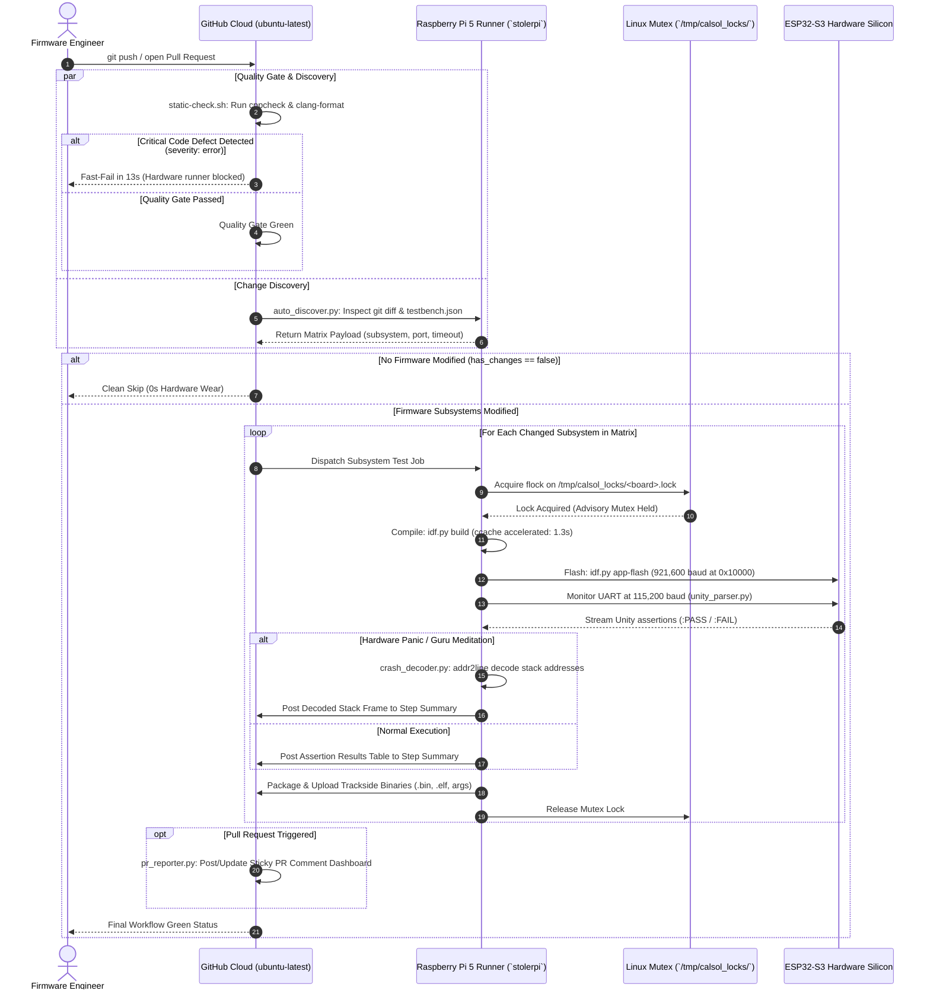
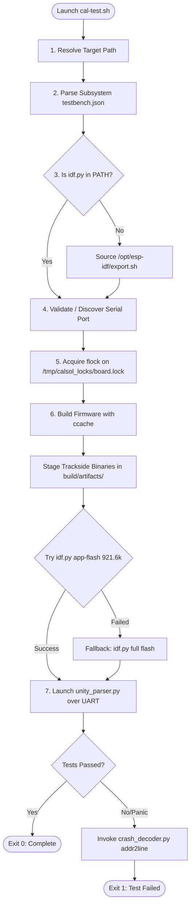

# CalSol Hardware Testbench & GitHub Actions CI Engine: Comprehensive Architecture & Setup Manual

This document is the authoritative technical specification and operational manual for the **CalSol Hardware-in-the-Loop (HIL) Continuous Integration (CI) Engine** deployed in the `github-action/` directory of the CalSol CAN Testbench repository.

---

## Table of Contents
1. [Executive Summary & Design Philosophy](#1-executive-summary--design-philosophy)
2. [End-to-End System Architecture](#2-end-to-end-system-architecture)
3. [Repository & Directory Architecture](#3-repository--directory-architecture)
4. [Monorepo Hardware Configuration: `testbench.json`](#4-monorepo-hardware-configuration-testbenchjson)
5. [Code-Level Walkthrough: What Every File Does](#5-code-level-walkthrough-what-every-file-does)
   - [A. Master Test Runner: `github-action/cal-test.sh`](#a-master-test-runner-github-actioncal-testsh)
   - [B. Standalone Flasher: `github-action/cal-flash.sh`](#b-standalone-flasher-github-actioncal-flashsh)
   - [C. Pre-Hardware Cloud Quality Gate: `static-check.sh` & `lib/static_check.py`](#c-pre-hardware-cloud-quality-gate-static-checksh--libstatic_checkpy)
   - [D. Subsystem Auto-Discovery: `lib/auto_discover.py`](#d-subsystem-auto-discovery-libauto_discoverpy)
   - [E. UART Stream Parser & Reporter: `lib/unity_parser.py`](#e-uart-stream-parser--reporter-libunity_parserpy)
   - [F. Crash Post-Mortem & Backtrace Decoder: `lib/crash_decoder.py`](#f-crash-post-mortem--backtrace-decoder-libcrash_decoderpy)
   - [G. Sticky PR Dashboard Bot: `lib/pr_reporter.py`](#g-sticky-pr-dashboard-bot-libpr_reporterpy)
   - [H. Code Style Standard: `.clang-format`](#h-code-style-standard-clang-format)
   - [I. Workflow Definitions: `unit-test.yml` & `testbench.yml`](#i-workflow-definitions-unit-testyml--testbenchyml)
6. [Step-by-Step Setup Guide: Making the CI Work from Scratch](#6-step-by-step-setup-guide-making-the-ci-work-from-scratch)
   - [Phase 1: Raspberry Pi Hardware Bench Setup (`stolerpi`)](#phase-1-raspberry-pi-hardware-bench-setup-stolerpi)
   - [Phase 2: ESP-IDF Toolchain & Build Acceleration Setup](#phase-2-esp-idf-toolchain--build-acceleration-setup)
   - [Phase 3: Persistent USB Device Symlinks (`udev`)](#phase-3-persistent-usb-device-symlinks-udev)
   - [Phase 4: GitHub Actions Runner Daemon & Systemd Linger](#phase-4-github-actions-runner-daemon--systemd-linger)
   - [Phase 5: Subsystem `testbench.json` Configuration](#phase-5-subsystem-testbenchjson-configuration)
   - [Phase 6: Repository Integration (The 13-Line Workflow)](#phase-6-repository-integration-the-13-line-workflow)
7. [Day-to-Day Operations & Developer Workflows](#7-day-to-day-operations--developer-workflows)
8. [Comprehensive Troubleshooting & Diagnostics Manual](#8-comprehensive-troubleshooting--diagnostics-manual)

---

## 1. Executive Summary & Design Philosophy

Traditional software CI pipelines execute inside virtual machines or cloud containers (e.g. `ubuntu-latest`). While suitable for purely mathematical algorithms, **embedded firmware for physical solar electric vehicles (CalSol Gen11)** has physical hardware constraints that software emulation cannot duplicate:
- **Silicon Execution Dynamics:** Dual-core Xtensa LX7 register behavior, instruction pipeline caching, and hardware interrupts.
- **Real-Time Operating System (FreeRTOS):** Hardware timer interrupts, context switching, task priority preemption, and queue-based inter-task synchronization.
- **Physical Electrical Peripherals:** Dedicated hardware TWAI (Two-Wire Automotive Interface / CAN 2.0B) controllers, physical transceivers, bus termination resistances, and high-speed UART bridges.

The **CalSol CAN Testbench Engine** is a true **Hardware-in-the-Loop (HIL)** automated test pipeline. Cloud GitHub Actions orchestrate fast static analysis and dependency resolution, while physical compilation, flashing, execution, and verification run on physical microcontrollers connected to a bench **Raspberry Pi 5 (`stolerpi`)**.

### Core Engineering Requirements Met:
1. **Zero Hardware Wear on Doc Changes:** Changes to markdown files, python scripts, or documentation bypass hardware testing entirely.
2. **Selective Monorepo Matrix:** Modifying one subsystem (e.g. `pedals_fw`) only flashes and tests that subsystem's dedicated microcontroller, leaving other boards idle.
3. **54x Build Acceleration:** ESP-IDF builds utilize `ccache` to cache precompiled FreeRTOS and toolchain objects, slashing rebuild times from ~75s down to 1.3s.
4. **8x Flash Acceleration & Flash Longevity:** Flashing uses differential `app-flash` at 921,600 baud, writing only the modified application partition (`0x10000`) and preserving SPI flash endurance.
5. **Hardware Concurrency Protection:** Linux advisory file locking (`flock`) prevents simultaneous access or race conditions over physical UART ports.
6. **Pre-Hardware Fast-Fail Quality Gate:** Cloud containers execute `cppcheck` and `clang-format` in ~13 seconds, blocking hardware dispatch if memory leaks or critical bugs exist.
7. **Crash Backtrace Auto-Decoding:** Unhandled panics or FreeRTOS aborts have their raw hex addresses decoded to exact source files and line numbers via `addr2line`.
8. **Automated Trackside Binary Packaging:** Every successful build archives flashable binaries (`.bin`, `.elf`, `bootloader.bin`, `flasher_args.json`) for trackside pit-crew deployment.
9. **Sticky PR Status Dashboard:** Automatically posts and updates an in-place status comment on GitHub Pull Requests.

---

## 2. End-to-End System Architecture



---

## 3. Repository & Directory Architecture

```text
CAN_TestBench/
├── .clang-format               # Universal repository C/C++ style rules (4-space, 120-col)
├── .gitignore                  # Git ignore patterns (build artifacts, locks, caches)
├── README.md                   # Repository overview and quickstart
│
├── .github/
│   └── workflows/
│       ├── testbench.yml       # Centralized reusable HIL workflow (for external callers)
│       └── unit-test.yml       # Monorepo CI workflow with direct PR/Push triggers
│
├── github-action/              # Hardware Testbench Runner Engine
│   ├── action.yml              # GitHub Composite Action definition
│   ├── cal-test.sh             # Master build, mutex, flash, and test orchestrator
│   ├── cal-flash.sh            # Standalone mutex flashing utility for pre-built binaries
│   ├── static-check.sh         # Cloud pre-hardware quality gate launcher
│   ├── README.md               # Engine technical documentation
│   └── lib/
│       ├── __init__.py         # Python package marker
│       ├── auto_discover.py    # Subsystem discovery & Git change detection engine
│       ├── static_check.py     # Cppcheck & Clang-Format quality gate runner
│       ├── unity_parser.py     # UART serial monitor, token matcher & JSON logger
│       ├── crash_decoder.py    # Hardware panic detector & addr2line backtrace decoder
│       └── pr_reporter.py      # Sticky GitHub PR comment dashboard generator
│
├── components/                 # Shared Firmware Components
│   └── can_driver/             # Universal CalSol CAN / TWAI driver
│       ├── CAN.h               # Public CAN API header
│       └── CAN_driver.c        # On-chip TWAI controller driver implementation
│
├── lights_fw/                  # Brakelights & Hazards Subsystem
│   ├── testbench.json          # Subsystem hardware config (port, baud, timeout)
│   ├── CMakeLists.txt          # ESP-IDF project definition
│   ├── main/                   # Production firmware code
│   └── test/                   # Unity on-target test suite
│
├── pedals_fw/                  # Accelerator & Brake Plausibility Subsystem
│   ├── testbench.json          # Subsystem hardware config (port, baud, timeout)
│   ├── CMakeLists.txt          # ESP-IDF project definition
│   ├── main/                   # Production firmware code
│   └── test/                   # Unity on-target test suite
│
├── Slack_Bot/                  # Bench Pi Slack Bot Daemon (Jonathan Ji)
└── unit-testing/
    └── fw-lab-examples/        # Firmware lab code & examples (Kyle Liang)
```

---

## 4. Monorepo Hardware Configuration: `testbench.json`

Every subsystem in the monorepo has its own `testbench.json` placed directly inside its root directory. This provides complete decoupling: changing an ECU's target board, flashing baud rate, or timeout requires **zero changes to CI workflows or bash scripts**.

### Formal Schema: `testbench.json`
```json
{
  "$schema": "http://json-schema.org/draft-07/schema#",
  "title": "CalSol Subsystem Testbench Configuration",
  "type": "object",
  "required": ["name", "target"],
  "properties": {
    "name": {
      "type": "string",
      "description": "Human-readable identifier displayed in GitHub Actions job titles and dashboards."
    },
    "target": {
      "type": "string",
      "description": "Relative path to the ESP-IDF CMake application to build and flash."
    },
    "port": {
      "type": "string",
      "description": "Designated serial device path or udev symlink on the bench Pi (e.g. /dev/esp32_johnathan). If omitted or empty, auto-detection is used."
    },
    "baud": {
      "type": "integer",
      "default": 921600,
      "description": "High-speed UART flashing baud rate. Supported rates: 115200, 460800, 921600, 1500000, 2000000."
    },
    "timeout": {
      "type": "integer",
      "default": 12,
      "description": "Maximum duration in seconds to wait for Unity assertion results before declaring a timeout fault."
    },
    "description": {
      "type": "string",
      "description": "Optional architectural description of the ECU subsystem."
    }
  }
}
```

### Production Examples in Repo:
- **`lights_fw/testbench.json`**:
  ```json
  {
    "name": "lights_fw",
    "target": "lights_fw/test",
    "port": "/dev/esp32_johnathan",
    "baud": 921600,
    "timeout": 12,
    "description": "Brakelights & Hazards ECU testbench configuration"
  }
  ```
- **`pedals_fw/testbench.json`**:
  ```json
  {
    "name": "pedals_fw",
    "target": "pedals_fw/test",
    "port": "/dev/esp32_ahmed",
    "baud": 921600,
    "timeout": 12,
    "description": "Accelerator & Brake Plausibility ECU testbench configuration"
  }
  ```

---

## 5. Code-Level Walkthrough: What Every File Does

### A. Master Test Runner: `github-action/cal-test.sh`
Located at [`github-action/cal-test.sh`](file:///C:/JuneKim0712/CAN_TestBench/github-action/cal-test.sh).

This bash script orchestrates the build, flash, and test execution lifecycle on the Raspberry Pi runner. It is designed to work both inside automated CI and interactively via SSH.



#### Detailed Section Breakdown:
1. **Target Resolution (Lines 13–29):** Accepts a target folder or binary path as argument `$1` (defaulting to `lights_fw/test`). Verifies directory existence and resolves absolute paths.
2. **Subsystem Configuration Ingestion (Lines 31–54):** Discovers `testbench.json` in the target folder or parent directory. Invokes Python one-liners to extract `port`, `timeout`, `baud`, and `name`.
3. **Toolchain Environment Discovery (Lines 56–66):** Checks if `idf.py` is in `$PATH`. If missing, automatically sources `/opt/esp-idf/export.sh` or `~/esp/esp-idf/export.sh`.
4. **Serial Port Discovery & Fallback (Lines 68–86):** Checks whether the configured port exists in `/dev/`. If unplugged, logs a warning and iterates through candidate devices (`/dev/steering`, `/dev/esp32_johnathan`, `/dev/bms`, `/dev/esp32_ahmed`, `/dev/ttyACM*`).
5. **Hardware Advisory Locking (`flock`) (Lines 92–100):** Namespaces locks per physical board:
   ```bash
   LOCK_FILE="/tmp/calsol_locks/${BOARD_NAME}.lock"
   exec 200>"$LOCK_FILE"
   flock -w 15 200
   ```
   Locks file descriptor `200`. Waits up to 15 seconds if another job is using the board; aborts with a clean error message if the lock cannot be acquired.
6. **Compiler Acceleration via `ccache` (Lines 110–125):** Exports `IDF_CCACHE_ENABLE=1` and `CCACHE_DIR="${HOME}/.ccache"`. Automatically sets target silicon to `esp32s3` if `sdkconfig` does not exist.
7. **Trackside Binary Staging (Lines 127–134):** Copies `.bin`, `.elf`, `bootloader.bin`, `partition-table.bin`, and `flasher_args.json` into `${TARGET}/build/artifacts/`.
8. **Differential Application Partition Flashing (`app-flash`) (Lines 136–148):** Flashes at 921,600 baud directly to application partition offset `0x10000`, taking **2.3 seconds** instead of ~18 seconds. Automatically falls back to full `flash` if partition tables or bootloaders need updating.
9. **Serial Monitoring & Assertion Evaluation (Lines 170–178):** Executes `unity_parser.py` with `--log-file` and `--output-json`.
10. **Crash Post-Mortem Hook (Lines 180–204):** If tests fail, checks for crash patterns in the serial log and invokes `crash_decoder.py` with the compiled `.elf` binary to translate crash addresses to exact C source lines.

---

### B. Standalone Flasher: `github-action/cal-flash.sh`
Located at [`github-action/cal-flash.sh`](file:///C:/JuneKim0712/CAN_TestBench/github-action/cal-flash.sh).

A lightweight utility for trackside engineers and developers to flash pre-built `.bin` files directly to hardware with mutex protection, bypassing compilation:
```bash
./github-action/cal-flash.sh build/pedals_fw.bin /dev/esp32_ahmed 921600
```
- Acquires `flock` on the designated port.
- Calls `esptool.py write_flash 0x10000 <binary>`.
- Automatically releases the mutex upon completion.

---

### C. Pre-Hardware Cloud Quality Gate: `static-check.sh` & `lib/static_check.py`
Located at [`github-action/static-check.sh`](file:///C:/JuneKim0712/CAN_TestBench/github-action/static-check.sh) and [`github-action/lib/static_check.py`](file:///C:/JuneKim0712/CAN_TestBench/github-action/lib/static_check.py).

Executes inside free GitHub Cloud containers (`ubuntu-latest`) in **~13 seconds** before physical microcontrollers are touched.

#### Functions in `static_check.py`:
- `find_c_files(repo_root)`: Traverses the repository to find all `.c` and `.h` files, ignoring `build/`, `managed_components/`, `.logs/`, and hidden folders.
- `check_clang_format(repo_root, c_files)`: Executes `clang-format --dry-run --Werror <file>`. Collects unformatted files for non-blocking style warnings.
- `run_cppcheck(repo_root)`: Executes `cppcheck` with embedded RTOS suppressions:
  ```python
  cmd = [
      "cppcheck",
      "--enable=warning,performance,portability",
      "--inline-suppr",
      "--suppress=missingInclude",
      "--suppress=missingIncludeSystem",
      "--suppress=unusedFunction",
      "--suppress=unmatchedSuppression",
      "--template=[{file}:{line}]: ({severity}) {message}"
  ] + target_dirs
  ```
- **Fast-Fail Decision Rule:**
  - Severity `error` (e.g. uninitialized stack buffers, NULL pointer dereferences, array out-of-bounds): **Fails with exit code 1**, blocking downstream hardware runners.
  - Severity `warning`, `performance`, `portability`, `style`: Treated as non-blocking suggestions displayed in `$GITHUB_STEP_SUMMARY`.

---

### D. Subsystem Auto-Discovery: `lib/auto_discover.py`
Located at [`github-action/lib/auto_discover.py`](file:///C:/JuneKim0712/CAN_TestBench/github-action/lib/auto_discover.py).

The dynamic heart of the monorepo pipeline. It dynamically builds the matrix for GitHub Actions.

#### Key Functions:
- `find_testbench_configs(repo_root)`: Scans the workspace for every folder containing `testbench.json`.
- `get_changed_files(repo_root)`: Determines which files were modified:
  - For Pull Requests: Evaluates `git diff --name-only origin/${GITHUB_BASE_REF}...HEAD`.
  - For Push events: Evaluates `git diff --name-only HEAD~1 HEAD`.
- `resolve_subsystems(all_configs, changed_files, input_target, port_override)`:
  - If `INPUT_TARGET` is a specific folder, tests only that folder.
  - If `INPUT_TARGET` is `"all"`, tests all discovered subsystems.
  - If `INPUT_TARGET` is `"auto"`:
    - Checks if changes touched shared dependencies (e.g. `components/can_driver/` or root headers). If yes, **all subsystems are flagged as dirty**.
    - If changes are isolated to one ECU folder (e.g. `pedals_fw/main/main.c`), **only `pedals_fw` is added to the matrix**.
    - If only documentation changed (`.md`, `.png`, `.txt`), returns an empty matrix with `has_changes = false`.
- `write_github_output(matrix, has_changes)`: Serializes matrix JSON and writes variables to `$GITHUB_OUTPUT`.

---

### E. UART Stream Parser & Reporter: `lib/unity_parser.py`
Located at [`github-action/lib/unity_parser.py`](file:///C:/JuneKim0712/CAN_TestBench/github-action/lib/unity_parser.py).

Connects to the ESP32's UART port over serial at 115,200 baud to evaluate unit tests.

#### Execution Logic:
1. Opens serial connection via `pyserial` (`serial.Serial(port, baud, timeout=0.5)`).
2. Reads lines until `timeout` seconds expire or Unity completion token (`Tests X Failures Y`) is observed.
3. Classifies assertion lines:
   - Contains `:PASS` $\rightarrow$ Logs green `✓ <test_name>`
   - Contains `:FAIL` $\rightarrow$ Logs red `✗ <test_name> (FAILED)`
4. Writes raw stream to `--log-file` for post-mortem debugging.
5. Emits a Markdown table to `$GITHUB_STEP_SUMMARY`:
   ```markdown
   | Status | Test Function | Details |
   | :---: | :--- | :--- |
   | ✅ | `test_throttle_deadzone` | `../main/test_main.c:42:test_throttle_deadzone:PASS` |
   | ✅ | `test_throttle_scaling` | `../main/test_main.c:48:test_throttle_scaling:PASS` |
   ```
6. Exports structured test data to `--output-json`.
7. Returns exit code `0` if and only if `0 Failures` was observed; otherwise returns `1`.

---

### F. Crash Post-Mortem & Backtrace Decoder: `lib/crash_decoder.py`
Located at [`github-action/lib/crash_decoder.py`](file:///C:/JuneKim0712/CAN_TestBench/github-action/lib/crash_decoder.py).

Translates raw hardware crashes into actionable source code line numbers.

#### Execution Logic:
1. Scans raw serial log for crash signatures:
   - `Guru Meditation Error`
   - `abort() was called at PC ...`
   - `assert failed: ...`
   - `Backtrace: 0x42008124:0x3fc92010 0x4200845a:0x3fc92030`
2. Extracts hexadecimal Program Counter (PC) addresses.
3. Automatically locates `xtensa-esp32s3-elf-addr2line` in PATH or `~/.espressif/tools/`.
4. Executes:
   ```bash
   xtensa-esp32s3-elf-addr2line -pfia -e build/<project>.elf 0x42008124 0x4200845a
   ```
5. Parses output and renders a Markdown crash analysis table:
   | Frame | Program Counter (PC) | Function Name | Source Location |
   | :---: | :---: | :--- | :--- |
   | **#0** | `0x42008124` | `calculate_throttle_percent` | `pedals_fw/main/main.c:42` |
   | **#1** | `0x4200845a` | `test_throttle_scaling` | `pedals_fw/test/main/test_main.c:68` |
   | **#2** | `0x42001a18` | `app_main` | `pedals_fw/test/main/test_main.c:110` |
6. Injects table into `$GITHUB_STEP_SUMMARY` and writes `crash_report.json`.

---

### G. Sticky PR Dashboard Bot: `lib/pr_reporter.py`
Located at [`github-action/lib/pr_reporter.py`](file:///C:/JuneKim0712/CAN_TestBench/github-action/lib/pr_reporter.py).

Maintains a single consolidated status dashboard comment on Pull Requests.

#### Execution Logic:
1. Runs at the end of Pull Request workflows (`if: always() && github.event_name == 'pull_request'`).
2. Scans `pr_artifacts/` for test results and crash reports.
3. Queries GitHub Actions REST API `/actions/runs/{run_id}/jobs` to inspect all job outcomes.
4. Generates a Markdown dashboard containing:
   - Pre-Hardware Quality Gate status (🟢 Passed / 🔴 Failed)
   - Matrix Hardware In-The-Loop test results table
   - Decoded crash stack frames (if any crash occurred)
5. Searches PR comments for the hidden tag `<!-- CALSOL_HIL_STATUS_COMMENT -->`:
   - If found $\rightarrow$ Updates existing comment via `PATCH /repos/{owner}/{repo}/issues/comments/{comment_id}`.
   - If not found $\rightarrow$ Creates new comment via `POST /repos/{owner}/{repo}/issues/{pr_number}/comments`.

---

### H. Code Style Standard: `.clang-format`
Located at [`.clang-format`](file:///C:/JuneKim0712/CAN_TestBench/.clang-format).

Standardizes formatting across all CalSol C/C++ firmware:
- Base style: LLVM / Google
- Indent width: 4 spaces (no tabs)
- Column limit: 120 characters
- Bracket style: Attach on functions, control statements, and structs

---

### I. Workflow Definitions: `unit-test.yml` & `testbench.yml`

- [`.github/workflows/unit-test.yml`](file:///C:/JuneKim0712/CAN_TestBench/.github/workflows/unit-test.yml): Primary monorepo workflow with triggers for `push`, `pull_request`, and `workflow_dispatch`. Includes the `static-analysis`, `discover`, `testbench` matrix, and `pr-report` jobs.
- [`.github/workflows/testbench.yml`](file:///C:/JuneKim0712/CAN_TestBench/.github/workflows/testbench.yml): Centralized reusable workflow (`workflow_call`) that other CalSol repositories (e.g. `Gen11-FW`) can call in a single line.

---

## 6. Step-by-Step Setup Guide: Making the CI Work from Scratch

Follow these instructions to configure a Raspberry Pi 5 bench runner and integrate repositories from zero.

### Phase 1: Raspberry Pi Hardware Bench Setup (`stolerpi`)

1. **Operating System:** Install 64-bit Raspberry Pi OS or Ubuntu Server 24.04 ARM64.
2. **Install Core System Packages:**
   ```bash
   sudo apt-get update
   sudo apt-get install -y git curl wget build-essential cmake ninja-build ccache python3-pip python3-venv libusb-1.0-0 libglib2.0-0
   ```
3. **Grant Serial Port Permissions:**
   Ensure the runner user (`jkim`) has permissions to access UART devices without sudo:
   ```bash
   sudo usermod -aG dialout,plugdev jkim
   ```

---

### Phase 2: ESP-IDF Toolchain & Build Acceleration Setup

1. **Install ESP-IDF v6.1+:**
   ```bash
   sudo mkdir -p /opt/esp-idf
   sudo chown -R jkim:jkim /opt/esp-idf
   git clone -b v6.1-beta1 --recursive https://github.com/espressif/esp-idf.git /opt/esp-idf
   cd /opt/esp-idf
   ./install.sh esp32s3
   ```
2. **Install Python Serial Dependency:**
   ```bash
   /opt/esp-idf/install.sh
   . /opt/esp-idf/export.sh
   pip install pyserial
   ```
3. **Configure Compiler Cache (`ccache`):**
   ```bash
   mkdir -p ~/.ccache
   echo 'max_size = 5.0G' > ~/.ccache/ccache.conf
   ```

---

### Phase 3: Persistent USB Device Symlinks (`udev`)

When multiple ESP32 boards are plugged into the Raspberry Pi via USB, default names like `/dev/ttyACM0` and `/dev/ttyACM1` can swap across reboots. To create persistent, human-readable symlinks:

1. **Identify USB Vendor & Product IDs / Serial Numbers:**
   ```bash
   udevadm info --name=/dev/ttyACM0 --attribute-walk | grep -E "idVendor|idProduct|serial"
   ```
2. **Create Udev Rules File (`/etc/udev/rules.d/99-calsol-esp32.rules`):**
   ```bash
   sudo nano /etc/udev/rules.d/99-calsol-esp32.rules
   ```
   Add entries matching your hardware serials:
   ```udev
   # Ahmed ESP32-S3 (Pedals ECU)
   SUBSYSTEM=="tty", ATTRS{idVendor}=="303a", ATTRS{idProduct}=="1001", ATTRS{serial}=="12345678", SYMLINK+="esp32_ahmed", MODE="0666"

   # Johnathan ESP32-S3 (Lights ECU)
   SUBSYSTEM=="tty", ATTRS{idVendor}=="303a", ATTRS{idProduct}=="1001", ATTRS{serial}=="87654321", SYMLINK+="esp32_johnathan", MODE="0666"
   ```
3. **Reload Rules:**
   ```bash
   sudo udevadm control --reload-rules && sudo udevadm trigger
   ```
4. **Verify Symlinks:**
   ```bash
   ls -l /dev/esp32_*
   # Should display:
   # /dev/esp32_ahmed -> ttyACM0
   # /dev/esp32_johnathan -> ttyACM1
   ```

---

### Phase 4: GitHub Actions Runner Daemon & Systemd Linger

1. **Download & Configure Runner:**
   Navigate to your GitHub Organization or Repo $\rightarrow$ Settings $\rightarrow$ Actions $\rightarrow$ Runners $\rightarrow$ New runner:
   ```bash
   mkdir ~/actions-runner && cd ~/actions-runner
   curl -o actions-runner-linux-arm64.tar.gz -L https://github.com/actions/runner/releases/download/v2.322.0/actions-runner-linux-arm64-2.322.0.tar.gz
   tar xzf actions-runner-linux-arm64.tar.gz
   ./config.sh --url https://github.com/CalSol/CAN_TestBench --token <REGISTRATION_TOKEN> --labels linux,ARM64,self-hosted
   ```
2. **Enable Systemd Lingering (CRITICAL):**
   > [!IMPORTANT]
   > Linux systemd shuts down user session services when the last SSH session disconnects, killing running tests with exit code 143 (`SIGTERM`). You **must** enable lingering:
   ```bash
   loginctl enable-linger jkim
   ```
   Verify lingering status:
   ```bash
   loginctl show-user jkim | grep Linger
   # Must output: Linger=yes
   ```
3. **Install & Start Systemd Service:**
   ```bash
   sudo ./svc.sh install jkim
   sudo ./svc.sh start
   sudo ./svc.sh status
   ```

---

### Phase 5: Subsystem `testbench.json` Configuration

In each firmware folder in your repository, create a `testbench.json` file:

```json
{
  "name": "bms_fw",
  "target": "bms_fw/test",
  "port": "/dev/esp32_ahmed",
  "baud": 921600,
  "timeout": 15,
  "description": "Battery Management System ECU unit test suite"
}
```

---

### Phase 6: Repository Integration (The 13-Line Workflow)

To enable automated testing in any CalSol repository (e.g. `CalSol/Gen11-FW`), create `.github/workflows/testbench.yml`:

```yaml
name: Hardware CI

on:
  push:
    branches: [ main ]
  pull_request:
    branches: [ main ]

jobs:
  test:
    name: Run CalSol Hardware Testbench
    uses: CalSol/CAN_TestBench/.github/workflows/testbench.yml@main
    with:
      target: 'auto'
```

That is all! The centralized engine automatically handles:
- Cloud linting & static analysis
- Changed file auto-discovery
- Matrix job generation
- Differential `app-flash` & `ccache` build execution
- Trackside binary artifact uploads

---

## 7. Day-to-Day Operations & Developer Workflows

### Manual Dispatch (Testing a Specific ECU on a Specific Port)
1. Navigate to **Actions** $\rightarrow$ **CalSol Hardware Unit Tests**.
2. Click **Run workflow**.
3. Under **Target subsystem**, enter: `pedals_fw` (or `"all"`).
4. Under **Serial port override**, enter: `/dev/esp32_ahmed` (or leave blank for default).
5. Click **Run workflow**.

### Trackside Binary Downloads for Pit-Crew Flashing
1. Open the green GitHub Actions run.
2. Scroll to the bottom **Artifacts** section.
3. Download `<subsystem>-firmware-binaries.zip`.
4. Flash the car at trackside with a laptop and USB cable:
   ```bash
   esptool.py --port /dev/ttyACM0 --baud 921600 write_flash 0x10000 pedals_fw_test.bin
   ```

---

## 8. Comprehensive Troubleshooting & Diagnostics Manual

### Issue 1: "Board is currently in use by another process"
- **Cause:** Another CI job, interactive SSH terminal, or background script is holding the `/tmp/calsol_locks/<board>.lock` advisory lock.
- **Diagnostic:**
  ```bash
  ssh jkim@stolerpi "lsof /tmp/calsol_locks/*.lock"
  ssh jkim@stolerpi "ps aux | grep -E 'cal-test|idf.py|python3'"
  ```
- **Resolution:** If a process is orphaned, kill it:
  ```bash
  ssh jkim@stolerpi "kill -9 <PID>"
  ```

### Issue 2: "Process completed with exit code 143 (Runner Shutdown)"
- **Cause:** Systemd lingering is disabled, and logging out of SSH terminated the user slice.
- **Resolution:**
  ```bash
  ssh jkim@stolerpi "loginctl enable-linger jkim"
  ```

### Issue 3: "Quality Gate FAILED: Critical defects detected"
- **Cause:** `cppcheck` detected an uninitialized variable, NULL pointer dereference, or out-of-bounds array access.
- **Diagnostic:** Check the **Cloud Lint & Static Analysis** job log or step summary.
- **Example Fix:**
  ```c
  // BAD: uninitialized buffer triggers cppcheck error
  uint8_t buffer[8];
  // GOOD: zero-initialized buffer passes quality gate
  uint8_t buffer[8] = {0};
  ```

### Issue 4: "Timed out (12s) waiting for Unity test output"
- **Cause:** Firmware crashed before UART initialized, microcontroller is in an infinite loop, or wrong baud rate was specified.
- **Diagnostic:** Inspect `github-action/.logs/<subsystem>_serial.log` on the Pi or read the decoded backtrace in the GitHub summary.
- **Resolution:** If the test legitimately requires more time (e.g. multi-second CAN timers), increase `"timeout": 20` in `testbench.json`.
