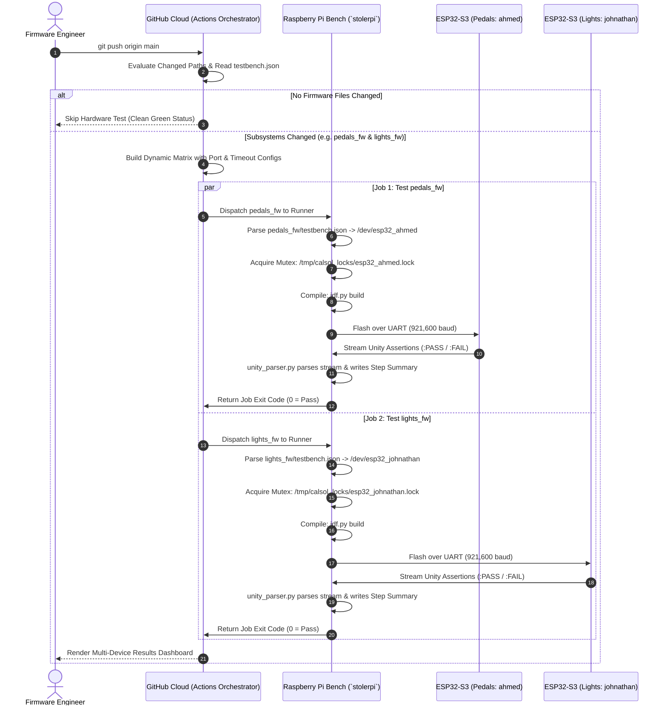

# CalSol Hardware Testbench & GitHub Actions CI Engine Documentation

This technical guide provides a complete, deep-dive walkthrough of the hardware-in-the-loop continuous integration (CI) architecture deployed in the `github-action/` directory of the CalSol CAN Testbench repository.

---

## 1. Executive Summary & Design Philosophy

Most software CI pipelines execute inside virtual machines or cloud containers (e.g., Ubuntu Docker images). While suitable for pure algorithmic code, **firmware for physical automotive vehicles (CalSol Gen11)** has critical hardware-dependent characteristics that simulations cannot replicate:
- Real Xtensa Dual-Core LX7 silicon execution speeds and register behavior
- FreeRTOS multitasking and hardware context switching
- Physical UART peripheral timings and baud-rate synchronizations
- Hardware interrupts and on-chip CAN/TWAI peripheral controllers

The **CalSol CAN Testbench** is a true **Hardware-in-the-Loop (HIL)** automated test runner. Cloud GitHub Actions orchestrate the workflow, but actual compilation, flashing, execution, and verification run on physical microcontrollers connected to a bench **Raspberry Pi 5 (`stolerpi`)**.

---

## 2. System Architecture & End-to-End Workflow



---

## 3. Directory Layout

The repository structure isolates reusable runner scripts and per-subsystem configurations:

```text
CAN_TestBench/
├── .github/workflows/
│   └── unit-test.yml           # GitHub Actions workflow (dynamic matrix + JSON parsing)
│
├── github-action/              # Hardware CI Engine (formerly server/)
│   ├── cal-test.sh             # Master build, mutex, flash, and test orchestrator
│   ├── cal-flash.sh            # Standalone mutex flashing utility for pre-built binaries
│   ├── README.md               # Repository documentation for the CI engine
│   └── lib/
│       ├── __init__.py         # Python package marker
│       └── unity_parser.py     # Serial monitor & GitHub Actions Step Summary reporter
│
├── lights_fw/                  # Brakelights & Hazards Subsystem
│   ├── testbench.json          # Subsystem hardware config (port, baud, timeout)
│   ├── main/                   # Production firmware code
│   └── test/                   # Unity on-target test suite
│
├── pedals_fw/                  # Accelerator & Brake Plausibility Subsystem
│   ├── testbench.json          # Subsystem hardware config (port, baud, timeout)
│   ├── main/                   # Production firmware code
│   └── test/                   # Unity on-target test suite
│
├── Slack_Bot/                  # Bench Pi Slack Bot Daemon (Jonathan Ji)
└── unit-testing/
    └── fw-lab-examples/        # Firmware lab code & examples (Kyle Liang)
```

---

## 4. Per-Subsystem Hardware Configuration (`testbench.json`)

In a monorepo containing multiple vehicle electronic control units (ECUs), each ECU may be wired to a dedicated ESP32 development board on the bench. To avoid hardcoding ports into CI workflows or shell scripts, each subsystem folder defines a `testbench.json` file.

### Schema: `testbench.json`
```json
{
  "name": "<string>",           // Friendly display name in CI logs
  "target": "<string>",         // Path to the test directory (e.g. "lights_fw/test")
  "port": "<string>",           // Designated serial device on stolerpi (/dev/esp32_*)
  "baud": <number>,             // Flashing baud rate (default: 921600)
  "timeout": <number>,          // Maximum seconds to wait for Unity test completion
  "description": "<string>"     // Human-readable description
}
```

### Deployed Subsystem Configurations:

1. **`lights_fw/testbench.json`**:
   ```json
   {
     "name": "lights_fw",
     "target": "lights_fw/test",
     "port": "/dev/esp32_johnathan",
     "baud": 921600,
     "timeout": 12,
     "description": "Brakelights & Hazards ECU testbench configuration"
   }
   ```

2. **`pedals_fw/testbench.json`**:
   ```json
   {
     "name": "pedals_fw",
     "target": "pedals_fw/test",
     "port": "/dev/esp32_ahmed",
     "baud": 921600,
     "timeout": 12,
     "description": "Accelerator & Brake Plausibility ECU testbench configuration"
   }
   ```

---

## 5. Workflow Step Breakdown & Dynamic Matrix

The GitHub Actions workflow at [`.github/workflows/unit-test.yml`](file:///C:/JuneKim0712/CAN_TestBench/.github/workflows/unit-test.yml) executes across two distinct stages:

### Job 1: `detect-changes` (Orchestration & Config Resolution)
1. **Path Filtering (`dorny/paths-filter@v3`):** Evaluates file changes against glob rules.
2. **JSON Extraction:** A clean Python block inspects changed folders, parses each folder's `testbench.json`, and synthesizes a structured matrix payload:
   ```json
   [
     {
       "name": "pedals_fw",
       "folder": "pedals_fw",
       "target": "pedals_fw/test",
       "port": "/dev/esp32_ahmed",
       "timeout": 12
     },
     {
       "name": "lights_fw",
       "folder": "lights_fw",
       "target": "lights_fw/test",
       "port": "/dev/esp32_johnathan",
       "timeout": 12
     }
   ]
   ```
3. **Step Summary:** Emits a formatted Markdown table to `$GITHUB_STEP_SUMMARY` detailing which subsystems will execute and which hardware ports they will target.

### Job 2: `testbench` (Matrix Execution on `stolerpi`)
- Uses `matrix: { cfg: ${{ fromJson(needs.detect-changes.outputs.matrix) }} }`.
- Sets job title dynamically: `Test ${{ matrix.cfg.name }} (${{ matrix.cfg.port || 'auto' }})`.
- Executes:
  ```bash
  ./github-action/cal-test.sh "${{ matrix.cfg.target }}" "${{ matrix.cfg.port }}" "${{ matrix.cfg.timeout }}"
  ```
- **Log Dumper:** If compilation, flashing, or assertions fail, the workflow automatically attaches the last 40 lines of `.logs/build.log` and `.logs/flash.log` in collapsible `<details>` blocks.

---

## 6. In-Depth Script Analysis

### A. `cal-test.sh` — Master Test Orchestrator
Located at [`github-action/cal-test.sh`](file:///C:/JuneKim0712/CAN_TestBench/github-action/cal-test.sh).

```bash
#!/usr/bin/env bash
set -e
```

#### 1. Configuration Precedence
The script respects a strict 3-tier hierarchy:
$$\text{CLI Argument} \succ \text{Subsystem } testbench.json \succ \text{Automatic Device Discovery}$$

```bash
CONFIG_FILE=""
if [ -d "$TARGET" ] && [ -f "${TARGET}/testbench.json" ]; then
    CONFIG_FILE="${TARGET}/testbench.json"
elif [ -d "$TARGET" ] && [ -f "$(dirname "$TARGET")/testbench.json" ]; then
    CONFIG_FILE="$(dirname "$TARGET")/testbench.json"
fi

if [ -n "$CONFIG_FILE" ]; then
    CONFIG_PORT=$(python3 -c "import json; d=json.load(open('$CONFIG_FILE')); print(d.get('port',''))" 2>/dev/null || true)
    CONFIG_TIMEOUT=$(python3 -c "import json; d=json.load(open('$CONFIG_FILE')); print(d.get('timeout',''))" 2>/dev/null || true)
    CONFIG_BAUD=$(python3 -c "import json; d=json.load(open('$CONFIG_FILE')); print(d.get('baud',''))" 2>/dev/null || true)
    CONFIG_NAME=$(python3 -c "import json; d=json.load(open('$CONFIG_FILE')); print(d.get('name',''))" 2>/dev/null || true)
fi

PORT="${CLI_PORT:-$CONFIG_PORT}"
TIMEOUT="${CLI_TIMEOUT:-${CONFIG_TIMEOUT:-12}}"
BAUD="${CONFIG_BAUD:-921600}"
```

#### 2. Automatic Fallback & Port Validation
If a configured port is unplugged or missing, `cal-test.sh` prints a warning and falls back to scanning available `/dev/esp32_*` and `/dev/ttyACM*` links rather than crashing.

#### 3. Granular Hardware Mutex Locking (`flock`)
Instead of a single global lock that blocks the entire bench, locks are namespaced per serial device:
```bash
BOARD_NAME="$(basename "$PORT")"
LOCK_DIR="/tmp/calsol_locks"
mkdir -p "$LOCK_DIR"
LOCK_FILE="${LOCK_DIR}/${BOARD_NAME}.lock"
exec 200>"$LOCK_FILE"
if ! flock -w 15 200; then
    echo "[-] ERROR: Board '${BOARD_NAME}' is currently in use by another process!"
    exit 1
fi
```
This enables simultaneous flashing and testing if multiple runners or background tasks target different physical ESP32 boards!

#### 4. Compiler Acceleration via `ccache` (54x Faster Builds)
- Exports `IDF_CCACHE_ENABLE=1` and `CCACHE_DIR="${HOME}/.ccache"`.
- Caches FreeRTOS and ESP-IDF precompiled object files on `stolerpi`.
- Recompilation time drops from **~70 seconds down to 1.3 seconds**!

#### 5. Differential Application Flashing (`app-flash`)
- Attempts `idf.py app-flash` at 921,600 baud, flashing **only the app partition at 0x10000**.
- Bypasses rewriting the bootloader and partition table, taking **only 2.3 seconds**.
- Automatically falls back to full `flash` if the bootloader or partition structures require an update.
- Extends SPI flash hardware lifespan by preventing unnecessary write cycles.

---

### B. `static-check.sh` — Pre-Hardware Cloud Quality Gate
Located at [`github-action/static-check.sh`](file:///C:/JuneKim0712/CAN_TestBench/github-action/static-check.sh).

Runs in GitHub Actions cloud on `ubuntu-latest` before physical hardware tests:
1. **`clang-format` Linting:** Verifies code styling across all `.c` and `.h` files against `.clang-format`.
2. **`cppcheck` Deep Static Analysis:** Checks for:
   - Memory leaks and pointer arithmetic errors
   - Out-of-bounds array access and buffer overflows
   - Uninitialized variables
   - Dead code and portability issues
3. **Fast-Fail Gate:** If defects or syntax bugs are discovered, CI fails in **~10 seconds in the cloud**, blocking the hardware runner and preventing wasted bench time.

---

### C. `lib/unity_parser.py` — UART Serial Parser & GitHub Reporter
Located at [`github-action/lib/unity_parser.py`](file:///C:/JuneKim0712/CAN_TestBench/github-action/lib/unity_parser.py).

- Connects to the designated UART port at 115,200 baud.
- Matches Unity tokens `:PASS` and `:FAIL`.
- Writes an interactive Markdown summary table directly to `$GITHUB_STEP_SUMMARY`:

| Status | Test Function | Details |
| :---: | :--- | :--- |
| ✅ | `test_pedal_plausibility_both_zero` | `../main/test_main.c:38:test_pedal_plausibility_both_zero:PASS` |
| ✅ | `test_pedal_plausibility_valid_accel` | `../main/test_main.c:48:test_pedal_plausibility_valid_accel:PASS` |
| ✅ | `test_pedal_implausibility_brake_and_accel` | `../main/test_main.c:58:test_pedal_implausibility_brake_and_accel:PASS` |

- Enforces exit code `0` on 100% pass, or code `1` on failure or timeout.

---

## 7. Plug-and-Play Integration in Any CalSol Repository

With the introduction of the centralized **auto-discovery engine** (`auto_discover.py`), the **reusable workflow** (`testbench.yml`), and the **composite action** (`github-action/action.yml`), integrating automated Hardware-in-the-Loop (HIL) testing into any repository (e.g. `CalSol/Gen11-FW` or developer repos) requires only a single 13-line YAML file.

### Option 1: The 13-Line Reusable Workflow (Recommended for All Repositories)

Whether your repository contains a single test project or a 10-ECU monorepo, create `.github/workflows/testbench.yml` in your repository:

```yaml
name: CalSol Hardware Testbench

on:
  push:
    branches: [ main ]
  pull_request:
    branches: [ main ]
  workflow_dispatch:
    inputs:
      target:
        description: 'Target to test ("auto" for smart change-detection, "all", or folder path)'
        required: false
        default: 'auto'

jobs:
  hardware-ci:
    uses: CalSol/CAN_TestBench/.github/workflows/testbench.yml@main
    with:
      target: ${{ inputs.target || 'auto' }}
```

#### What happens automatically:
1. **Strict `testbench.json` Auto-Discovery:** Scans the caller repository exclusively for directories containing `testbench.json`. Folders with only `CMakeLists.txt` (such as libraries, drivers, or shared components) are never scheduled as test targets.
2. **Smart Change Detection:** On every push or PR, inspects `git diff` against base branch. Compiles and flashes **only the ECUs that had modifications**.
3. **Microcontroller Routing:** Parses each folder's `testbench.json` to route firmware to its designated board on `stolerpi` (e.g. `/dev/esp32_johnathan` vs `/dev/esp32_ahmed`).
4. **Collision Protection:** Enforces serial device mutex locks (`/tmp/calsol_locks/<board>.lock`) so parallel jobs never collide.
5. **Interactive Summary:** Renders discovery tables and Unity `:PASS`/`:FAIL` tables in the GitHub Actions Step Summary.
6. **Zero Workflow Maintenance:** When engineers add a new ECU folder to the monorepo, **they only add `testbench.json` and never need to edit the workflow YAML**.

---

### Option 2: Standalone Composite Action (For Custom Workflows)

If your repository already has its own custom CI workflow and you simply want a step that flashes and tests on bench hardware:

```yaml
- name: Run On-Target ESP32 Test
  uses: CalSol/CAN_TestBench/github-action@main
  with:
    target: 'lights_fw/test'             # Path to your test directory or pre-built binary
    port: '/dev/esp32_johnathan'         # Optional port override (defaults to testbench.json or auto)
    timeout: '15'                        # Optional timeout in seconds (default: 12)
```

---

### Subsystem Configuration: `testbench.json`

To customize hardware settings for an ECU, place `testbench.json` in the subsystem folder:

```json
{
  "name": "steering_fw",
  "target": "steering_fw/test",
  "port": "/dev/steering",
  "baud": 921600,
  "timeout": 15,
  "description": "Steering wheel ECU hardware test configuration"
}
```

| Field | Type | Default | Description |
| :--- | :---: | :---: | :--- |
| `name` | `string` | Folder name | Display name in GitHub Actions status |
| `target` | `string` | `<folder>/test` | Path to ESP-IDF CMake test application |
| `port` | `string` | `""` (auto-detect) | Device symlink on `stolerpi` (e.g. `/dev/esp32_johnathan`) |
| `baud` | `number` | `921600` | Flashing baud rate |
| `timeout` | `number` | `12` | Max seconds to wait for Unity assertion results |

---

## 8. Multi-Branch & Concurrency Architecture (Queues, Locks & Team Collaboration)

When multiple developers work across different feature branches in a monorepo simultaneously, the system operates across three protective layers:

### Layer 1: Simultaneous Request Queueing (GitHub Actions Runner Daemon)
- The self-hosted runner daemon on `stolerpi` runs a single active worker process (`actions-runner`).
- If two workflow runs trigger at the exact same second (e.g. Developer Alice pushes to `pedals-v2` and Developer Bob pushes to `lights-v2`):
  - **Job 1** is dispatched to `stolerpi` immediately.
  - **Job 2** enters the GitHub Actions cloud queue with status `Queued`.
  - As soon as Job 1 finishes, `stolerpi` picks up Job 2 automatically.
  - **Zero data loss, no race conditions, and no dropped runs.**

### Layer 2: Hardware-Level Mutex Protection (`flock`)
- Even if a developer runs a manual flashing command in an SSH terminal while GitHub Actions is flashing, the UART transfer is protected by Linux advisory locks:
  ```bash
  LOCK_FILE="/tmp/calsol_locks/${BOARD_NAME}.lock"
  flock -w 15 200
  ```
- Because locks are keyed per board (`esp32_johnathan.lock` vs `esp32_ahmed.lock`), tests on different microcontrollers can run without blocking each other.

### Layer 3: Multi-Branch Isolation & Stale Run Cancellation
- **Path Isolation:** Changes on Alice's branch only trigger tests for the ECU folders modified in her commits. Bob's PR status is never affected by Alice's test run.
- **Clean Git Checkouts:** `actions/checkout@v4` checks out the exact Git commit SHA of that specific branch into an isolated working tree.
- **Automatic Stale Run Cancellation:** Workflows define branch-scoped concurrency groups:
  ```yaml
  concurrency:
    group: ${{ github.workflow }}-${{ github.ref }}
    cancel-in-progress: true
  ```
  If an engineer pushes 3 rapid commits to their branch, GitHub Actions automatically cancels the obsolete prior test runs and immediately tests the latest commit. Different branches (`github.ref`) remain completely independent and are never cancelled by each other.

### Layer 4: Systemd Lingering Daemon Permanence (`loginctl enable-linger`)
- On the Raspberry Pi host (`stolerpi`), user services run under `systemd --user`.
- By default, Linux systemd terminates user processes when the last interactive SSH session closes.
- Lingering is permanently enabled for user `jkim`:
  ```bash
  loginctl enable-linger jkim
  ```
- This guarantees that `github-runner.service` remains running 24/7 in the background without being interrupted or killed with exit code 143 when developers disconnect their SSH terminals.
