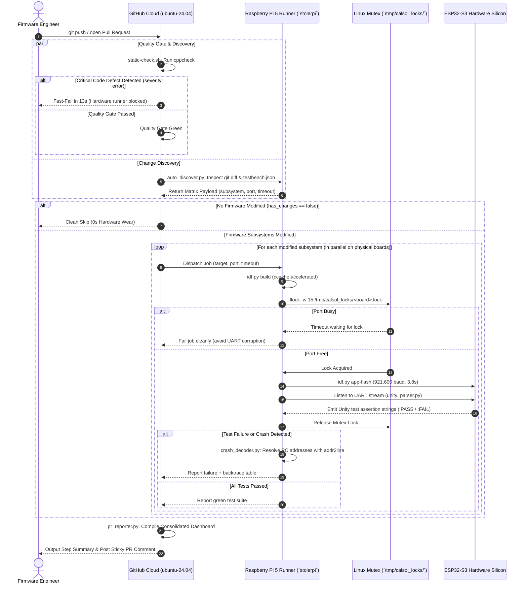

# CalSol Hardware Testbench & GitHub Actions CI Engine: Architecture & GitHub Setup Manual

This document is the authoritative technical specification and GitHub integration manual for the **CalSol Hardware-in-the-Loop (HIL) Continuous Integration (CI) Engine** deployed in the `github-action/` directory of the CalSol CAN Testbench repository.

---

## Table of Contents
1. [End-to-End System Architecture](#1-end-to-end-system-architecture)
2. [Repository & Directory Architecture](#2-repository--directory-architecture)
3. [Monorepo Hardware Configuration: `testbench.json`](#3-monorepo-hardware-configuration-testbenchjson)
4. [Code-Level Walkthrough: What Every File Does](#4-code-level-walkthrough-what-every-file-does)
   - [A. Master Test Runner: `github-action/cal-test.sh`](#a-master-test-runner-github-actioncal-testsh)
   - [B. Standalone Flasher: `github-action/cal-flash.sh`](#b-standalone-flasher-github-actioncal-flashsh)
   - [C. Pre-Hardware Cloud Quality Gate: `static-check.sh` & `lib/static_check.py`](#c-pre-hardware-cloud-quality-gate-static-checksh--libstatic_checkpy)
   - [D. Subsystem Auto-Discovery: `lib/auto_discover.py`](#d-subsystem-auto-discovery-libauto_discoverpy)
   - [E. UART Stream Parser & Reporter: `lib/unity_parser.py`](#e-uart-stream-parser--reporter-libunity_parserpy)
   - [F. Crash Post-Mortem & Backtrace Decoder: `lib/crash_decoder.py`](#f-crash-post-mortem--backtrace-decoder-libcrash_decoderpy)
   - [G. Status Dashboard & PR Reporter Bot: `lib/pr_reporter.py`](#g-status-dashboard--pr-reporter-bot-libpr_reporterpy)
   - [H. Workflow Definitions: `unit-test.yml` & `testbench.yml`](#h-workflow-definitions-unit-testyml--testbenchyml)
5. [GitHub Setup & Repository Integration Guide](#5-github-setup--repository-integration-guide)
   - [Step 1: Create `testbench.json` in Subsystem Directories](#step-1-create-testbenchjson-in-subsystem-directories)
   - [Step 2: Add the 13-Line Reusable Workflow (`.github/workflows/testbench.yml`)](#step-2-add-the-13-line-reusable-workflow-githubworkflowstestbenchyml)
   - [Step 3: Configure GitHub Repository Permissions](#step-3-configure-github-repository-permissions)
6. [Day-to-Day Operations & Developer Workflows](#6-day-to-day-operations--developer-workflows)
   - [Manual Workflow Dispatch](#manual-workflow-dispatch)
   - [Downloading Trackside Binaries](#downloading-trackside-binaries)
7. [Comprehensive Troubleshooting & Diagnostics Manual](#7-comprehensive-troubleshooting--diagnostics-manual)

---

## 1. End-to-End System Architecture

The **CalSol CAN Testbench Engine** is an automated Hardware-in-the-Loop (HIL) testing pipeline. Cloud GitHub Actions orchestrate fast static analysis and dependency resolution, while physical compilation, flashing, execution, and verification run on physical microcontrollers connected to a bench **Raspberry Pi 5 (`stolerpi`)**.



---

## 2. Repository & Directory Architecture

```text
CAN_TestBench/
├── .github/
│   └── workflows/
│       ├── unit-test.yml           # Monorepo CI workflow (push, PR, dispatch)
│       └── testbench.yml           # Central reusable workflow (workflow_call)
├── github-action/                  # Action & Hardware Test Runner Tooling
│   ├── action.yml                  # GitHub Composite Action definition
│   ├── cal-test.sh                 # Master hardware test runner & binary stager
│   ├── cal-flash.sh                # Standalone manual hardware flashing tool
│   ├── static-check.sh             # Cloud quality gate entrypoint
│   ├── README.md                   # Repository technical manual
│   └── lib/                        # Modular Python engine libraries
│       ├── static_check.py         # Cppcheck static analysis quality gate runner
│       ├── auto_discover.py        # Git diff inspector & matrix builder
│       ├── unity_parser.py         # Serial UART reader & Unity result parser
│       ├── crash_decoder.py        # ESP32 Guru Meditation backtrace decoder
│       └── pr_reporter.py          # Consolidated status dashboard & PR bot
├── components/
│   └── can_driver/                 # Shared repository-wide CAN bus driver
├── lights_fw/
│   ├── testbench.json              # Subsystem HIL hardware configuration
│   ├── main/                       # Operational firmware source
│   └── test/                       # Unity test suite (CMakeLists.txt, main/)
└── pedals_fw/
    ├── testbench.json              # Subsystem HIL hardware configuration
    ├── main/                       # Operational firmware source
    └── test/                       # Unity test suite (CMakeLists.txt, main/)
```

---

## 3. Monorepo Hardware Configuration: `testbench.json`

Every ECU or subsystem directory in the repository declares its hardware requirements using a `testbench.json` file in its root directory.

### Complete Schema:

```json
{
  "name": "pedals_fw",
  "target": "pedals_fw/test",
  "port": "/dev/esp32_ahmed",
  "baud": 921600,
  "timeout": 12,
  "description": "Pedals & Throttle Plausibility ECU Unit Tests"
}
```

### Parameter Reference:

| Field | Type | Default | Description |
| :--- | :---: | :---: | :--- |
| `name` | `string` | *(Folder name)* | Human-readable identifier shown in GitHub matrix job titles and status reports. |
| `target` | `string` | `test` | Relative path to the test project directory containing `CMakeLists.txt` and `main/`. |
| `port` | `string` | `""` | Dedicated `/dev/` serial port symlink for this ECU on the runner. If left empty `""`, the runner auto-detects an available ESP32. |
| `baud` | `integer` | `921600` | Flashing baud rate over USB. `921600` achieves ~3.8-second flashing for 200 KB test binaries. |
| `timeout` | `integer` | `12` | Maximum duration (in seconds) the runner will listen on UART for Unity output before failing. |
| `description` | `string` | `""` | Optional human-readable documentation for engineers. |

---

## 4. Code-Level Walkthrough: What Every File Does

### A. Master Test Runner: `github-action/cal-test.sh`
Located at [`github-action/cal-test.sh`](file:///C:/JuneKim0712/CAN_TestBench/github-action/cal-test.sh).

This bash script is executed directly on the Raspberry Pi runner (or locally by an engineer at the bench).

#### Detailed Step-by-Step Execution:
1. **Target & Configuration Resolution:**
   - Reads `$1` (target directory), `$2` (serial port override), `$3` (timeout override).
   - Locates `testbench.json` in the target folder or parent folder.
   - Extracts `port`, `baud`, `timeout`, and `name` using Python one-liners.
2. **Toolchain Environment Injection:**
   - Checks if `idf.py` is present in the shell PATH.
   - If missing, automatically sources `/opt/esp-idf/export.sh` or `~/esp/esp-idf/export.sh`.
3. **Port Auto-Detection & Fallback:**
   - Checks if the configured port exists in `/dev/`.
   - If not found or left blank, probes known persistent device symlinks (`/dev/steering`, `/dev/esp32_johnathan`, `/dev/bms`, `/dev/esp32_ahmed`, `/dev/ttyACM0`).
4. **Hardware Mutual Exclusion Locking (`flock`):**
   - Opens file descriptor 200 on `/tmp/calsol_locks/<board_name>.lock`.
   - Executes `flock -w 15 200`. If another process holds the port, waits up to 15 seconds. If the lock cannot be acquired, aborts cleanly to prevent UART and flash corruption.
5. **Compilation with Build Acceleration:**
   - Sets `export IDF_CCACHE_ENABLE=1` and `export CCACHE_DIR="${HOME}/.ccache"`.
   - Runs `idf.py build > .logs/build.log 2>&1`. If sdkconfig is missing, runs `idf.py set-target esp32s3` first.
6. **Trackside Binary Artifact Staging:**
   - Creates directory `<target>/build/artifacts/`.
   - Copies flashable outputs: `*.bin`, `*.elf`, `bootloader/bootloader.bin`, `partition_table/partition-table.bin`, and `flasher_args.json`.
7. **Differential App-Partition Flashing:**
   - Attempts fast `idf.py -p <port> -b <baud> app-flash` (flashes only the modified application partition at `0x10000`, bypassing bootloader and partition table rewrite).
   - If app-flash fails (e.g. partition table was modified), falls back to full `idf.py -p <port> -b <baud> flash`.
8. **Unity UART Stream Capture:**
   - Invokes `lib/unity_parser.py` on the port with the specified timeout.
9. **Crash Decoding on Failure:**
   - If tests fail or abort, checks for `<target>/build/*.elf` and `.logs/<subsystem>_serial.log`.
   - Invokes `lib/crash_decoder.py` to translate any panic backtraces into source code line numbers.
   - Copies `test_results.json` and `crash_report.json` into `<target>/build/artifacts/`.
10. **Exit Status Propagation:**
    - Exits with the exact return code of `unity_parser.py` (0 for pass, 1 for failure).

---

### B. Standalone Flasher: `github-action/cal-flash.sh`
Located at [`github-action/cal-flash.sh`](file:///C:/JuneKim0712/CAN_TestBench/github-action/cal-flash.sh).

Used by engineers for rapid flashing of pre-compiled binaries without running tests:
```bash
./github-action/cal-flash.sh build/pedals_fw.bin /dev/esp32_ahmed 921600
```
- Acquires `flock` on the designated port.
- Calls `esptool.py write_flash 0x10000 <binary>`.
- Automatically releases the mutex upon completion.

---

### C. Pre-Hardware Cloud Quality Gate: `static-check.sh` & `lib/static_check.py`
Located at [`github-action/static-check.sh`](file:///C:/JuneKim0712/CAN_TestBench/github-action/static-check.sh) and [`github-action/lib/static_check.py`](file:///C:/JuneKim0712/CAN_TestBench/github-action/lib/static_check.py).

Executes inside free GitHub Cloud containers (`ubuntu-24.04`) in **~13 seconds** before physical microcontrollers are touched.

#### Functions in `static_check.py`:
- `find_c_files(repo_root)`: Traverses the repository to find all `.c` and `.h` files, ignoring `build/`, `managed_components/`, `.logs/`, and hidden folders.
- `run_cppcheck(repo_root)`: Executes `cppcheck` with embedded RTOS suppressions:
  ```python
  cmd = [
      "cppcheck",
      "--enable=warning,performance,portability",
      "--inline-suppr",
      "--suppress=missingInclude",
      "--suppress=missingIncludeSystem",
      "--suppress=unusedFunction",
      "--suppress=unmatchedSuppression",
      "--template=[{file}:{line}]: ({severity}) {message}"
  ] + target_dirs
  ```
- **Fast-Fail Decision Rule:**
  - Severity `error` (e.g. uninitialized stack buffers, NULL pointer dereferences, array out-of-bounds): **Fails with exit code 1**, blocking downstream hardware runners.
  - Severity `warning`, `performance`, `portability`, `style`: Treated as non-blocking suggestions displayed in `$GITHUB_STEP_SUMMARY`.

---

### D. Subsystem Auto-Discovery: `lib/auto_discover.py`
Located at [`github-action/lib/auto_discover.py`](file:///C:/JuneKim0712/CAN_TestBench/github-action/lib/auto_discover.py).

The dynamic heart of the monorepo pipeline. It dynamically builds the matrix for GitHub Actions.

#### Key Functions:
- `find_testbench_configs(repo_root)`: Scans the workspace for every folder containing `testbench.json`.
- `get_changed_files(repo_root)`: Determines which files were modified:
  - For Pull Requests: Evaluates `git diff --name-only origin/${GITHUB_BASE_REF}...HEAD`.
  - For Push events: Evaluates `git diff --name-only HEAD~1 HEAD`.
- `resolve_subsystems(all_configs, changed_files, input_target, port_override)`:
  - If `INPUT_TARGET` is a specific folder, tests only that folder.
  - If `INPUT_TARGET` is `"all"`, tests all discovered subsystems.
  - If `INPUT_TARGET` is `"auto"`:
    - Checks if changes touched shared dependencies (e.g. `components/can_driver/` or root headers). If yes, **all subsystems are flagged as dirty**.
    - Otherwise, checks if changed files belong to a specific subsystem directory.
- `export_to_github_env(matrix, has_changes)`:
  - Outputs `matrix={"include": [...]}` and `has_changes=true/false` to `$GITHUB_OUTPUT`.
  - If `has_changes == false`, GitHub Actions cleanly skips hardware runner jobs.

---

### E. UART Stream Parser & Reporter: `lib/unity_parser.py`
Located at [`github-action/lib/unity_parser.py`](file:///C:/JuneKim0712/CAN_TestBench/github-action/lib/unity_parser.py).

Monitors serial communication during hardware test execution.

#### Processing Pipeline:
1. Connects to the designated UART port (`pyserial`) at 115,200 baud.
2. Reads incoming lines until the Unity summary string appears (`Tests 0 Failures 0 Ignored`) or timeout expires.
3. Detects assertion strings:
   - `<file>:<line>:<function>:PASS` $\rightarrow$ Records pass assertion.
   - `<file>:<line>:<function>:FAIL:<reason>` $\rightarrow$ Records failure assertion.
4. Saves raw output to `.logs/<subsystem>_serial.log` for post-mortem analysis.
5. Injects a Markdown table into `$GITHUB_STEP_SUMMARY`:
   | Status | Test Function | Details |
   | :---: | :--- | :--- |
   | PASS | `test_throttle_deadzone` | `../main/test_main.c:42:test_throttle_deadzone:PASS` |
   | PASS | `test_throttle_scaling` | `../main/test_main.c:48:test_throttle_scaling:PASS` |
6. Emits structured JSON (`<subsystem>_test_results.json`) containing total assertions, pass/fail counts, and execution status.

---

### F. Crash Post-Mortem & Backtrace Decoder: `lib/crash_decoder.py`
Located at [`github-action/lib/crash_decoder.py`](file:///C:/JuneKim0712/CAN_TestBench/github-action/lib/crash_decoder.py).

Automatically decodes raw microcontroller crashes in CI without requiring an interactive debugger.

#### Crash Detection & Decoding Flow:
1. Scans `.logs/<subsystem>_serial.log` for Espressif panic patterns:
   - `Guru Meditation Error: ...`
   - `abort() was called at ...`
   - `assert failed: ...`
   - `Backtrace: 0x42008124:0x3fc92010 0x4200845a:0x3fc92030`
2. Extracts hexadecimal Program Counter (PC) addresses.
3. Automatically locates `xtensa-esp32s3-elf-addr2line` in PATH or `~/.espressif/tools/`.
4. Executes:
   ```bash
   xtensa-esp32s3-elf-addr2line -pfia -e build/<project>.elf 0x42008124 0x4200845a
   ```
5. Parses output and renders a Markdown crash analysis table:
   | Frame | Program Counter (PC) | Function Name | Source Location |
   | :---: | :---: | :--- | :--- |
   | **#0** | `0x42008124` | `calculate_throttle_percent` | `pedals_fw/main/main.c:42` |
   | **#1** | `0x4200845a` | `test_throttle_scaling` | `pedals_fw/test/main/test_main.c:68` |
   | **#2** | `0x42001a18` | `app_main` | `pedals_fw/test/main/test_main.c:110` |
6. Injects table into `$GITHUB_STEP_SUMMARY` and writes `crash_report.json`.

---

### G. Status Dashboard & PR Reporter Bot: `lib/pr_reporter.py`
Located at [`github-action/lib/pr_reporter.py`](file:///C:/JuneKim0712/CAN_TestBench/github-action/lib/pr_reporter.py).

Maintains a unified status dashboard across GitHub Actions Step Summaries (`$GITHUB_STEP_SUMMARY`) and Pull Request comments.

#### Execution Logic:
1. Runs at the conclusion of all workflows (`if: always()`).
2. Scans `pr_artifacts/` for test results (`*_test_results.json`) and crash reports (`*_crash_report.json`).
3. Queries the GitHub Actions REST API `/actions/runs/{run_id}/jobs` to inspect all job outcomes.
4. Generates a Markdown dashboard containing:
   - Pre-Hardware Quality Gate status (Passed / Failed)
   - Matrix Hardware In-The-Loop test results table with assertion counts
   - Subsystem-by-subsystem detailed test assertion outcomes (PASS / FAIL)
   - Decoded crash stack frames (if any crash occurred)
5. Writes the dashboard to `$GITHUB_STEP_SUMMARY` so it is visible directly in the run summary tab.
6. If executed on a Pull Request, searches PR comments for the hidden tag `<!-- CALSOL_HIL_STATUS_COMMENT -->`:
   - If found $\rightarrow$ Updates existing comment via `PATCH /repos/{owner}/{repo}/issues/comments/{comment_id}`.
   - If not found $\rightarrow$ Creates new comment via `POST /repos/{owner}/{repo}/issues/{pr_number}/comments`.

---

### H. Workflow Definitions: `unit-test.yml` & `testbench.yml`

- [`.github/workflows/unit-test.yml`](file:///C:/JuneKim0712/CAN_TestBench/.github/workflows/unit-test.yml): Primary monorepo workflow with triggers for `push`, `pull_request`, and `workflow_dispatch`. Includes the `static-analysis`, `discover`, `testbench` matrix, and `report` jobs.
- [`.github/workflows/testbench.yml`](file:///C:/JuneKim0712/CAN_TestBench/.github/workflows/testbench.yml): Centralized reusable workflow (`workflow_call`) that other CalSol repositories (e.g. `Gen11-FW`) can call in a single line.
- Both workflows target **Node 24** (`actions/checkout@v5`, `actions/upload-artifact@v7`, `actions/download-artifact@v8`) on **Ubuntu 24.04 LTS** (`ubuntu-24.04`), ensuring clean builds without deprecation warnings.

---

## 5. GitHub Setup & Repository Integration Guide

This guide covers everything required inside GitHub to connect a repository to the CalSol Hardware Testbench.

### Step 1: Create `testbench.json` in Subsystem Directories

In your firmware repository, place a `testbench.json` in the root folder of each ECU or subsystem you want to test.

**Example: `bms_fw/testbench.json`**
```json
{
  "name": "bms_fw",
  "target": "bms_fw/test",
  "port": "/dev/esp32_ahmed",
  "baud": 921600,
  "timeout": 15,
  "description": "Battery Management System ECU unit test suite"
}
```

#### Field Explanations:
- `name`: Display name shown in GitHub Actions jobs and reports.
- `target`: Path to the ESP-IDF test project containing `CMakeLists.txt` and `main/`.
- `port`: The designated symlink of the microcontroller on the bench (e.g. `/dev/esp32_ahmed` or `/dev/esp32_johnathan`). Omit or leave empty `""` to auto-detect any connected ESP32.
- `baud`: Flashing baud rate (`921600` recommended).
- `timeout`: Maximum test duration in seconds (default: `12`).

---

### Step 2: Add the 13-Line Reusable Workflow (`.github/workflows/testbench.yml`)

In your repository, create the file `.github/workflows/testbench.yml`:

```yaml
name: CalSol Hardware CI

on:
  push:
    branches: [ main ]
  pull_request:
    branches: [ main ]
  workflow_dispatch:

jobs:
  hardware-ci:
    name: Run CalSol Hardware Testbench
    uses: CalSol/CAN_TestBench/.github/workflows/testbench.yml@main
    with:
      target: 'auto'
```

#### What this workflow automatically does:
1. **Pre-Hardware Cloud Quality Gate:** Runs `cppcheck` in cloud containers (`ubuntu-24.04`) before dispatching to hardware.
2. **Auto-Discovery:** Automatically scans your repo for `testbench.json` files and inspects Git diffs to test only modified ECUs.
3. **Hardware Execution:** Dispatches tests to the bench runner with `ccache` acceleration and differential `app-flash`.
4. **Artifact Uploads:** Archives flashable `.bin` and `.elf` files with a 14-day retention period.
5. **Dashboard Generation:** Publishes consolidated test results and failure logs to GitHub Actions Step Summary and PR comments.

---

### Step 3: Configure GitHub Repository Permissions

For the automated test runner and sticky PR comment bot to work properly, verify the following repository settings:

1. **Enable Workflow Pull Request Write Permissions:**
   - Go to your repository on GitHub.
   - Click **Settings** $\rightarrow$ **Actions** $\rightarrow$ **General**.
   - Scroll down to **Workflow permissions**.
   - Select **Read and write permissions**.
   - Check the box: **Allow GitHub Actions to create and approve pull requests**.
   - Click **Save**.
   *(This allows the `report` job to post and update sticky status comments on Pull Requests).*

2. **Allow Access to Reusable Workflows (Organization Repositories):**
   - In `CalSol/CAN_TestBench` $\rightarrow$ **Settings** $\rightarrow$ **Actions** $\rightarrow$ **General**.
   - Scroll down to **Access**.
   - Ensure **Accessible from repositories in the 'CalSol' organization** is selected.

---

## 6. Day-to-Day Operations & Developer Workflows

### Manual Workflow Dispatch
You can trigger hardware tests on demand without making a commit:
1. Navigate to **Actions** $\rightarrow$ **CalSol Hardware CI** (or **CalSol Hardware Unit Tests**).
2. Click **Run workflow**.
3. Under **Target subsystem**, enter:
   - `"auto"`: Tests only modified subsystems.
   - `"all"`: Forces tests across every subsystem in the repository.
   - Specific path (e.g. `pedals_fw`): Tests only that ECU.
4. Under **Serial port override**, enter an optional port (e.g. `/dev/esp32_ahmed`), or leave blank to use `testbench.json`.
5. Click **Run workflow**.

### Downloading Trackside Binaries
Trackside engineers can download pre-compiled, tested binaries to flash at the car:
1. Open the successful GitHub Actions run.
2. Scroll to the **Artifacts** section at the bottom.
3. Download `<subsystem>-firmware-binaries.zip`.
4. Extract and flash with a single command:
   ```bash
   esptool.py --port /dev/ttyACM0 --baud 921600 write_flash 0x10000 pedals_fw_test.bin
   ```

---

## 7. Comprehensive Troubleshooting & Diagnostics Manual

### Issue 1: "Board is currently in use by another process"
- **Cause:** Another CI job, interactive SSH terminal, or background script is holding the `/tmp/calsol_locks/<board>.lock` advisory lock.
- **Diagnostic:**
  ```bash
  ssh jkim@stolerpi "lsof /tmp/calsol_locks/*.lock"
  ssh jkim@stolerpi "ps aux | grep -E 'cal-test|idf.py|python3'"
  ```
- **Resolution:** If an orphaned process remains, kill it:
  ```bash
  ssh jkim@stolerpi "kill -9 <PID>"
  ```

### Issue 2: "Process completed with exit code 143 (Runner Shutdown)"
- **Cause:** Systemd user lingering is disabled on the host, causing SSH disconnects to terminate running tests.
- **Resolution:**
  ```bash
  ssh jkim@stolerpi "loginctl enable-linger jkim"
  ```

### Issue 3: "Quality Gate FAILED: Critical defects detected"
- **Cause:** `cppcheck` detected an uninitialized variable, NULL pointer dereference, or out-of-bounds array access.
- **Diagnostic:** Check the **Cloud Lint & Static Analysis** job log or step summary.
- **Example Fix:**
  ```c
  // BAD: uninitialized buffer triggers cppcheck error
  uint8_t buffer[8];
  // GOOD: zero-initialized buffer passes quality gate
  uint8_t buffer[8] = {0};
  ```

### Issue 4: "Timed out (12s) waiting for Unity test output"
- **Cause:** Firmware crashed before UART initialized, microcontroller is in an infinite loop, or wrong baud rate was specified.
- **Diagnostic:** Inspect the Decoded Crash Backtrace table in the step summary or check `github-action/.logs/<subsystem>_serial.log`.
- **Resolution:** If the test legitimately requires more time (e.g. multi-second CAN timers), increase `"timeout": 20` in `testbench.json`.
